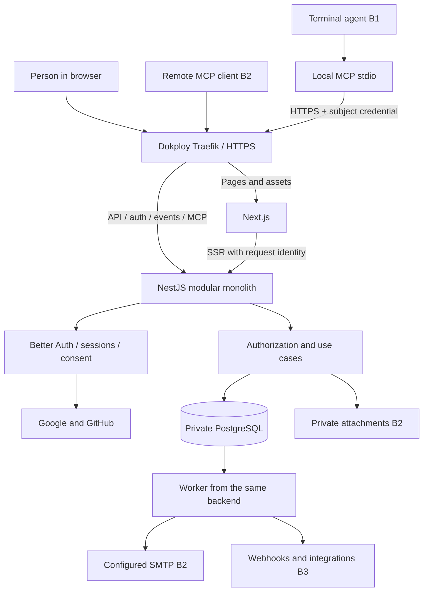
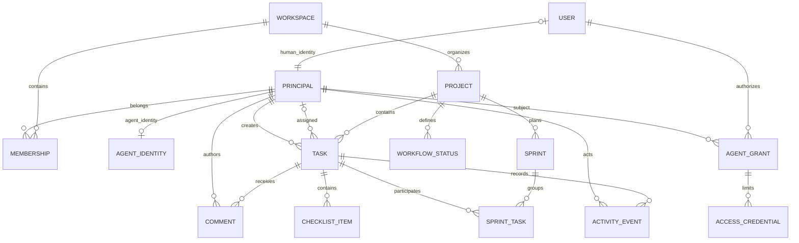
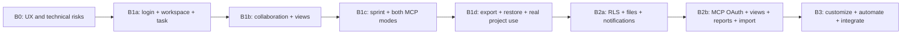

# Rielia — Architecture and technical plan

**Contract revision — October 24, 2026:** one launch and continuous updates; delegated user authorship and own identity for autonomous agents. P38, US24–US25, T35, and A11 formalize the change.

**Marketing and assets addition:** October 24, 2026; landing and v0.1 kit added to scope.

**Plan and research date:** October 18, 2026.  
**UI/UX direction update:** October 24, 2026; stack and brand availability research not repeated.  
**Status:** planning proposal; does not represent an implemented application.  
**Working name:** Rielia; commercial, trademark, and domain availability unconfirmed.  
**Audience:** founder and product, design, engineering, and community contributors.

**Spanish version:** [Arquitectura y plan técnico](02-arquitectura-plan-tecnico.es.md).  
**Companion documents:** [Product plan](01-product.en.md) · [Brand strategy and development](03-branding.en.md) · [UI/UX development guide](04-ui-ux-development-guide.en.md) · [Landing](05-landing-page-plan.en.md) · [Assets](06-brand-assets-guide.en.md).  
**Agent entry point:** [START HERE](00-START-HERE.md).

## Contents

- [0. Context and scope](#0-context-and-scope)
- [1. Architecture and technical comparison](#1-architecture-and-technical-comparison)
- [2. Identity, permissions, and isolation](#2-identity-permissions-and-isolation)
- [3. Domain and data](#3-domain-and-data)
- [4. API, events, and collaboration](#4-api-events-and-collaboration)
- [5. MCP and development agents](#5-mcp-and-development-agents)
- [6. Docker, Dokploy, and operations](#6-docker-dokploy-and-operations)
- [7. Development plan and backlog](#7-development-plan-and-backlog)
- [8. Quality, risks, and decisions](#8-quality-risks-and-decisions)
- [9. Next decisions and starting package](#9-next-decisions-and-starting-package)

---

## 0. Context and scope

This document defines architecture and engineering delivery for an open project, task, and sprint application used through the web and agents. The recommendation is a Next.js + NestJS monorepo, PostgreSQL, Better Auth, and containers operated with Dokploy. Decisions are proposals subject to the described spikes; the system has not been implemented or deployed.

Product requirements and stories P01–P38 and US01–US25 live in the product document; tickets T01–T35 and ADRs A01–A11 remain here. B0–B3 are internal work batches: foundations, core, readiness, and evolution. There is one public launch followed by continuous updates; these are not public access stages.

Reference files `product-development-strategist.md` and `development-planning-architect.md` inform the methodology; their internal instructions do not replace the user request or authorize execution.

### 0.1 Evidence and assumptions

| Type | Content | Consequence |
| --- | --- | --- |
| Confirmed by the user | Personal and third-party use; open source; tasks and sprints; social login; VPS with Dokploy; Docker; PostgreSQL or another DB in Dokploy; MCP; responsive | Baseline constraints |
| Planning assumption | New project, initially maintained by one person or a small team | Small architecture and vertical delivery |
| Product assumption | First users: independent developers and teams of 2–15 people | Simplify hierarchy and onboarding; validate the segment |
| Deployment assumption | One installation can contain multiple isolated workspaces | Multiuser and multitenant data model from the outset |
| Access assumption | Open, invitation-only, or closed registration configured per installation | Supports a personal instance and an open installation |
| Language assumption | Spanish and English, without automatic translation of user content | Internationalization foundations from the start |
| Unknown | Current VPS resources, budget, availability, and target date | No promised schedule or measured capacity |
| Unknown | Launch countries, local obligations, and monetization policy | Review before opening a public service |
| Researched | Linked public documentation, consulted on October 18, 2026 | Supports documented capabilities; does not prove compatibility in this project |

Recommendations are reasoned design decisions, not interview findings, benchmarks, or integration test results.

## 1. Architecture and technical comparison

### 1.1 Decision criteria

Proposed order of importance: correctness and isolation → maintainability and operability → equivalent web/agent access → delivery speed → portability → measured performance. Future scale alone does not justify more services.

### 1.2 Full Next.js versus Next.js + NestJS

| Criterion | Next.js for frontend and backend | Next.js + NestJS monorepo |
| --- | --- | --- |
| Initial setup and deployment | Fewer applications and less configuration | More setup and two application runtimes |
| Stable public API | Viable with Route Handlers and disciplined domain design | Explicit API boundary independent of UI conventions |
| MCP | Viable in Node and/or a separate adapter | Backend adapter accessing shared use cases |
| Durable jobs | Separate worker required if jobs must survive requests/restarts | Worker from the same backend with its own bootstrap |
| Events and persistent connections | Possible on a private server; depends on hosting and organization | Natural responsibility of the API service |
| Modules, injection, and permissions | Requires establishing conventions | Nest provides modules and guards; permissions still require design |
| Single-VPS operations | Smaller surface for a small app | Higher baseline consumption, but API and web can be limited and restarted separately |
| Open-source contribution | Lower initial barriers; risk of coupling business logic and pages | Clear boundaries when documented; more concepts for contributors |
| Cost of changing direction | Extracting a backend later requires work | Some separation cost paid upfront |

**Recommendation:** Next.js + NestJS with a modular monolithic backend. The rationale is a product with two first-class interfaces—web and agents—a stable API, and planned asynchronous work. This does not mean Next.js cannot support it or NestJS guarantees better performance.

Next.js documentation presents Backend for Frontend capabilities and explains their limits. On a VPS, serverless-function limitations must not be confused with intrinsic framework limitations. Sources: [Next.js Backend for Frontend](https://nextjs.org/docs/app/guides/backend-for-frontend), [self-hosting Next.js](https://nextjs.org/docs/app/guides/self-hosting), and [NestJS architecture](https://docs.nestjs.com/).

**When to choose full Next.js:** if scope is reduced to personal use, limited collaboration, and limited MCP, and the dominant priority is shipping the first tool as one application. Keep the domain in independent modules and add a worker when needed; do not make this a mandatory temporary step before Nest.

### 1.3 Proposed stack

| Layer | Choice | Function and boundary |
| --- | --- | --- |
| Language/runtime | Strict TypeScript and compatible Node LTS | One tool family; pin exact version during implementation |
| Monorepo | pnpm workspaces; Turborepo when pipeline benefits justify it | Reuse contracts and speed tasks without building an internal platform |
| Web | Next.js App Router + React | Navigation, initial rendering, and interactive experience |
| UI | Tailwind CSS + accessible shadcn/ui-based components | Own token system and design control |
| Client data | TanStack Query | Remote state, invalidation, and optimistic changes |
| Local state | React; another store only for a demonstrated need | Avoid duplicating all server tasks in a global store |
| Drag and drop | dnd-kit after validating selected version | Reorder and move, always with an accessible alternative |
| Forms | React Hook Form + validation schemas | UX validation; server validates again |
| Backend | NestJS with Express adapter initially | Use cases, permissions, API, events, auth, and MCP adapter |
| Persistence | PostgreSQL and Prisma | Transactions, typed queries, and controlled migrations |
| Search | SQL and PostgreSQL full-text according to stage | Avoid another engine until measurements justify it |
| Jobs | Worker + PostgreSQL-backed pg-boss | Exports, emails, imports, and automation; no mandatory Redis |
| Identity | Better Auth mounted in Nest and official web clients | Identity/sessions; product permissions stay in the domain |
| Public contract | Versioned JSON REST + OpenAPI | Web, integrations, and local wrapper share contracts |
| MCP | Official TypeScript SDK compatible with pinned revision | Transport and protocol; own business rules outside tools |
| Web updates | SSE invalidation events | No simultaneous text coediting or offline synchronization |
| Attachments | Private volume for simple installations; S3-compatible adapter | Permission behavior independent of storage |
| Quality | Compatible unit runner, API tests, and Playwright | Domain, isolation, workflows, and responsive behavior |
| Operations | Docker, Dokploy, structured logs, and essential metrics | Enough visibility without a heavy observability stack initially |

These are proposed choices, not dependencies already tested together. Pin versions with a lockfile, compatibility checks, and security-advisory review in B0. Do not deploy production with `latest` tags.

Reference documentation: [TanStack Query remote state](https://tanstack.com/query/latest/docs/framework/react/overview), [dnd-kit](https://dndkit.com/), [NestJS OpenAPI](https://docs.nestjs.com/openapi/introduction), [Prisma transactions](https://www.prisma.io/docs/orm/fundamentals/transactions), and [pg-boss](https://github.com/timgit/pg-boss).

### 1.4 Components and sources of truth



**Responsibilities:**

- Next.js owns presentation state. It does not access task tables or apply alternative sprint rules.
- NestJS owns product use cases and authorization. Its REST controllers and MCP tools invoke the same services.
- Better Auth owns the identity/session lifecycle. The domain references its user; do not duplicate users or memberships through plugins without explicit design.
- PostgreSQL is the source of truth for tasks, memberships, audit, grants, and jobs. Client cache and SSE are auxiliary.
- The worker reuses backend modules and processes durable effects; it is not a microservice with an independent business model.
- The local MCP wrapper has no database or privileged permissions. It uses the API with the human or autonomous agent subject's restricted credential.

### 1.5 Monorepo structure

```text
apps/
  web/                       # Next.js
  api/                       # NestJS and domain modules
    src/modules/
      identity/
      workspaces/
      projects/
      tasks/
      sprints/
      activity/
      agents/                # grants, PATs, and agent policies
      mcp/                   # remote adapter B2
      files/                 # B2
      notifications/         # B2
      integrations/          # B3
    src/worker.ts            # bootstrap without web server
  mcp-local/                 # installable stdio process
packages/
  contracts/                 # DTO schemas, errors, and public types
  api-client/                # generated from OpenAPI
  database/                  # Prisma schema and migrations; backend/worker only
  ui/                        # shared components and tokens
  tooling/                   # minimal shared configuration
infra/
  docker/
  compose.dev.yml
  compose.selfhost.yml
  compose.dokploy.yml
docs/
  architecture/adr/
  api/
  mcp/
  self-hosting/
  contributing/
```

Dependency rules: `web` never imports `database`; `contracts` does not import Nest/Prisma; `mcp-local` depends on contracts/API client, not internal domain code. The worker loads only necessary modules. Do not add one package per entity or a full CQRS framework without a need.

## 2. Identity, permissions, and isolation

### 2.1 Authentication comparison

The decision must support social login, self-hosting, revocable sessions, documentation for other installations, and future MCP-client authorization. Authenticating a person and authorizing an agent are separate flows.

| Option | Project fit | Operations and cost | Portability and risk | Recommendation |
| --- | --- | --- | --- | --- |
| Auth.js / NextAuth | Social login and close Next.js integration | Auth inside your infrastructure; you maintain updates | Less direct fit with Nest and MCP authorization server; review exact stable/beta branch | Valid with existing experience and a concrete reason to choose it |
| Auth0 | External identity provider with social connections | External service and commercial terms; dockerizing your app does not make it self-hosted | Coupling to tenant/configuration and identity migration | Choose if delegating identity operations outweighs autonomy |
| Better Auth | TypeScript, application-hosted identity, and documented OAuth/MCP extensions | No mandatory SaaS service for the proposed core; own operations | Community Nest integration and compatibility requiring validation | **First candidate for this new project** |

Maintainers announced that Auth.js moved to the Better Auth team and recommend Better Auth for new projects, while continuing to address Auth.js security and critical issues. This influences the recommendation but does not replace an integration spike. Sources: [maintainer announcement](https://better-auth.com/blog/authjs-joins-better-auth), [Auth.js](https://authjs.dev/), [Better Auth introduction](https://better-auth.com/docs/introduction), and [Auth0 social connections](https://auth0.com/docs/authenticate/identity-providers/social-identity-providers).

**If strictly choosing between NextAuth and Auth0:** for this self-hosting goal, choose Auth.js with database sessions and a Nest integration spike; Auth0 only if you accept the external dependency. The overall recommendation is to evaluate Better Auth first. Do not introduce both identity engines simultaneously.

### 2.2 Proposed integration and required spike

Mount Better Auth under `/api/auth/*` in NestJS; Next.js uses its client. The backend then resolves sessions through the library's supported API rather than interpreting another framework's private cookies.

The official guide notes that NestJS integration is **community-maintained** and that this integration's Fastify support is beta. Therefore Express is proposed initially. Review mounting, body parsing, cookies, and guards with selected versions. Do not accidentally disable parsing/validation for the rest of the API. Source: [Better Auth NestJS integration](https://better-auth.com/docs/integrations/nestjs).

The B0 spike must demonstrate Google/GitHub login, web/API sessions, logout, expiry, access removal, cookies behind Traefik, and mounting compatible with a minimal MCP endpoint. If it fails, compare direct mounting through supported APIs with another library before expanding the product.

### 2.3 Web-session flow

1. The person chooses a configured provider.
2. The backend initiates OAuth/OIDC according to provider and verifies supported flow mechanisms, including state/PKCE/nonce where applicable.
3. The callback resolves identity by provider and stable subject identifier, not email alone.
4. An application session is created in PostgreSQL with a secure, `HttpOnly`, host-scoped cookie and a `SameSite` policy appropriate to the flow.
5. Every operation resolves session and current membership; the frontend is not a security boundary.
6. Logout, suspension, and revocation prevent new operations; do not rely solely on session caches retaining revoked permissions.

Do not automatically merge accounts based on an unverified matching email. Linking a second provider requires an existing session and appropriate verification. Test GitHub private email and account recovery before opening registration.

Google and GitHub require credentials and callbacks per installation. Operators configure their own OAuth applications; never distribute a shared secret in the repository. Sources: [Google in Better Auth](https://better-auth.com/docs/authentication/google) and [GitHub in Better Auth](https://better-auth.com/docs/authentication/github).

### 2.4 Origin and request protection

Use one public origin, for example `https://app.example.com`:

| Public route | Owning service |
| --- | --- |
| Pages, assets, and interface routes | Next.js |
| `/api/auth/*` | Identity mounted in Nest |
| `/api/v1/*` | Product API |
| `/events` | Web-update SSE |
| `/mcp` | Remote MCP B2 |
| Required `/.well-known/*` routes | Corresponding identity/MCP handler |

Document and test route priorities and rewrites; Next's catch-all must not swallow OAuth discovery. Trust proxy headers only from the known proxy. For cookie-authenticated mutations, apply origin and CSRF controls according to framework. CORS does not replace authorization.

### 2.5 Roles and policies

| Action | Owner | Admin | Member | Viewer | Guest B2 |
| --- | --- | --- | --- | --- | --- |
| View workspace projects and authorized private projects | Yes | Yes | Yes | Yes | Assigned projects only |
| Create/edit tasks and comment | Yes | Yes | Yes, where access permits | No | Comments if granted |
| Create workspace-visible projects | Yes | Yes | Yes under initial policy | No | No |
| Plan/start/close sprints | Yes | Yes | Yes in editable projects | No | No |
| Invite/remove members and change roles | Yes | Yes, excluding owner | No | No | No |
| Manage project visibility and private access | Yes | Yes | Only as authorized project lead | No | No |
| Create delegated connection on own behalf | Yes | Yes | Yes, limited to own permissions | Read-only | No in B2 |
| Register/suspend autonomous agent and issue its credential | Yes | Yes, limited role/projects | No | No | No |
| Transfer ownership or delete workspace | Yes, with reauthentication | No | No | No | No |

“Private” means explicit access; decide in B0 whether owner/admin can administer without reading content. Initial proposal: owner/admin have administrative and content access to every project in their workspace, communicated clearly. Do not promise privacy from an installation operator controlling the database.

Effective permissions use the actual grant subject: current membership, project access, scopes, granted limits, and operation policy. The delegated subject is the user; the autonomous subject is the registered agent. Role elevation never automatically broadens a grant. Autonomous identity belongs in core B1 rather than being deferred until future demand.

### 2.6 Multitenancy

Shared database with `workspace_id` in every domain entity, mandatory repository filters, and composite foreign keys preventing cross-tenant relationships. Context derives from verified identity and membership; a client-supplied `workspaceId` selects but never authorizes.

Add PostgreSQL RLS as a second barrier for domain tables **before public launch**, using a runtime role without `BYPASSRLS`, per-transaction context (`SET LOCAL` or safe equivalent), tested pooled connections, and default-deny policies. Migration role is separate; review global identity tables separately. Documentation explains that table owners and privileged roles can bypass policies under certain conditions: [PostgreSQL row security](https://www.postgresql.org/docs/current/ddl-rowsecurity.html).

During internal B1 development, filters and constraints remain mandatory; MVP authorization cannot depend on future RLS to fix flaws. Test lists, search, counts, exports, events, jobs, and downloads with users from two workspaces.

### 2.7 Subject, execution, and credential

**A product decision, not an identity mandated by MCP:** clients and connections are not members by themselves. The protocol enables authorized access; Rielia defines domain authorship. References verified October 24, 2026: [MCP authorization](https://modelcontextprotocol.io/specification/2026-07-28/basic/authorization), [MCP security](https://modelcontextprotocol.io/docs/2026-07-28/tutorials/security/security_best_practices).

- **Human principal:** linked one-to-one with auth `User`. Web sessions and delegated grants point to that same principal.
- **Agent principal:** nonhuman identity registered within one workspace, with its own membership and access. No fictional social user. Limited member/viewer role; cannot be owner/admin or administer people, credentials, or leads.
- **System principal:** reserved for internal automations, without login or ordinary task assignment. Preserve action cause.
- **Connection/grant:** `mode=delegated` binds `subjectPrincipalId` to the authorizing human; `mode=autonomous` binds it to a registered agent. `authorizedByUserId` records who granted access, not each operation's author. `managedByUserId` is the human custodian, without lending that human's permissions.

Server resolves a verified `ExecutionContext`: `actorPrincipalId`, `executionMode` (human/delegated/autonomous/system), `source`, relevant `connectionId`/`grantId`, and correlation. Clients cannot choose these values. Provenance comes from the endpoint and authenticated connection, not arbitrary headers. Displayed client name identifies the configured connection; it does not prove which binary used its token.

Delegation: current human permissions ∩ project access ∩ grant ∩ policy. Autonomy: current agent permissions ∩ project access ∩ grant ∩ policy, never the registering administrator's role. Check principal state and revocation for every operation, including jobs, exports, and ChangeSet application.

Operations reserved for human interaction require a valid web session and reauthentication when applicable; also check `executionMode`. A delegated call with `principalKind=human` and Luis as author is not a human interaction and cannot administer members, credentials, or installation through MCP.

Connection revocation blocks that access; agent suspension or membership removal blocks all corresponding connections. When the last human custodian leaves, explicitly transfer management to an active administrator or suspend the agent. Management transfer does not change subject, authorship, or privileges. Preserve historical principal/connection references or tombstones under retention policy; never reattribute activity to the administrator.

An agent principal cannot gain memberships in another workspace: validate `AgentIdentity.workspaceId`, membership, and project consistency with policy and appropriate constraints/triggers. Enforce identity kind and unique human linkage in DB rather than DTOs alone.

Task `createdByPrincipalId` and comment `authorPrincipalId` are fixed at creation; separate `assigneePrincipalId` accepts an active authorized human/agent in scope or null. Updates record their own actor. Reject attempts to set author, subject, or mode in task/comment payloads. Do not switch an existing connection's mode: issue another with an explicit subject.

## 3. Domain and data

### 3.1 Entities

| Entity | Relevant fields and relationships | Main invariant |
| --- | --- | --- |
| Principal / AgentIdentity | ID, human/agent/system kind and state; agent scoped to workspace with human custodian | Kind matches identity: human linked to User, agent to AgentIdentity, internal system; no fictional social accounts |
| User / Account / Session | Identity, provider, session, and verification managed by auth | A provider subject is linked unambiguously |
| Workspace | Name, slug, owner, settings, and quotas | Always retains an active owner |
| Membership | Workspace, human/agent principal, role, state | Unique per principal/workspace; owner always human |
| Invitation | Recipient, role, token hash, expiry, and consumption | Single-use token; cannot grant privileges beyond issuer's |
| Project / ProjectMember | Workspace, key, mode, visibility, and access | Key unique within workspace; explicit private access |
| WorkflowStatus | Project, name, category, and order | Required categories and at least one valid entry status |
| Task | Workspace/project, number, content/status, `createdByPrincipalId`, `assigneePrincipalId`, parent, version, archive | Immutable creator; independent assignee; remaining P05 properties; authorized principal in same scope |
| Label / TaskLabel | Label and assignment | No label from another workspace |
| ChecklistItem | Task, text, order, and completion | Does not imply automatic task completion |
| Sprint | Project, goal, interval, time zone, and state | One active per project; idempotent closing |
| SprintTask | Sprint, task, entry/exit, points, and historical result | Preserves participations; only one current assignment |
| SprintScopeEvent | Entry, removal, estimate change, and completion | Reconstructable scope over time |
| Comment | Task, `authorPrincipalId`, content, version, creation provenance | Server-resolved author; inherited access and sanitized content |
| Attachment B2 | Task, storage key, detected MIME, size, hash, and state | Download checks current permissions |
| ActivityEvent | `actorPrincipalId`, mode, source, connection/grant, entity, safe changes, correlation, date | Same commit as mutation; preserves delegated human/autonomous agent/system |
| AgentConnection / AgentGrant | Mode, `subjectPrincipalId`, authorizer, client, scopes/projects, expiry/revocation | Immutable credential-derived subject; authorizer never replaces actor |
| AccessCredential | Personal/service/oauth kind, subject/grant, prefix/hash or provider reference, expiry, last use | Personal for human, service for agent; no secret recoverable through UI |
| OAuth client/consent/token B2 | Tables owned by selected authorization provider | Consent per client/resource; distinct from social login |
| IdempotencyRecord | Principal/grant, operation, key, request hash, and response | Same key with different payload rejected |
| OutboxEvent | Durable event, minimal payload, version, and delivery state | Created in the same transaction as the business change |
| AgentRun / ChangeSet B2 | Proposed operations, state, expected versions, and approval | Approval cannot bypass permissions or conflicts |
| SavedView / Notification B2 | Filters and recipients | A view never broadens permissions |
| CustomField / Value B3 | Type, definition, scope, and value | Typed validation and explicit type migration |
| AutomationRule / Integration B3 | Rules, encrypted credentials, and deliveries | Limits, causality, and deduplication |

### 3.2 Main relationships



### 3.3 Consistency, ordering, and concurrency

- Index `(workspace_id, project_id, status_id, rank)`, assignee, sprint, and dates. Test query plans against representative datasets before indiscriminately adding indexes.
- Atomic ticket-number generation per project with uniqueness constraint. Deleting tasks does not release numbers.
- Persist order with fractional ranking or another strategy validated in B0; transactional rebalancing and stable tie-breaker. Do not trust browser array indexes.
- Increment `version` on every mutation; `expectedVersion`/`If-Match` prevents lost updates.
- Keep transactions short; use limited retries for serialization conflicts where appropriate.
- Status change, activity recording, and outbox write occur in one transaction. Email and third-party calls happen afterward.
- Idempotency per principal/grant and operation; proposed initial retention of 7 days for agent/import mutations. Return a previous result only after checking the caller still has access to it.
- Depending on a parent does not authorize reading private children; queries apply policy per entity.
- Disable/sanitize raw HTML in descriptions/comments; safe links and size limits.
- JSONB for bounded filters and metadata, not the entire domain in one JSON document.

### 3.4 Sprint history and reports

At sprint start, save reference scope and estimates. Record additions, removals, point changes, and completion times. Freeze that period's outcome on closure; a ticket reopened later must not silently rewrite the closing report.

Burndown follows project-local dates; distinguish scope changes from completed work. Velocity uses completed work only and shows cancellations separately. Do not sum parent and child points when estimating the same work: define the counting level, initially top-level tasks with their own estimates and informational subtasks.

### 3.5 Export, import, and lifecycle

JSON is the complete portability format: schema version, projects, tasks, statuses, comments, authorship/principal type/provenance without secrets, relationships, and attachment references; never export credentials, sessions, or tokens. CSV supports editing or moving lists and does not claim to preserve all relationships.

B1 provides export; B2 adds import and a tested native-format round trip. Installation backup restoration is a different path and must work in B1. Exports include only entities visible to the requester; jobs recheck permissions before delivering the file.

Import cannot let external IDs impersonate the authenticated actor: record the importer as creation actor and retain original authorship as mapped/validated provenance metadata. Do not import credentials or create memberships merely from an author name.

Proposed initial policy: archived tasks remain until explicit deletion; if soft-delete trash is added, retain it for 30 days and distinguish it from archiving. Technical logs: 14 days; domain audit: configurable 180 days; temporary exports: 24 hours. Document account closure, ownership transfer, comment retention, and backup purge before public registration. These are pending product/operations decisions, not universal legal requirements.

## 4. API, events, and collaboration

### 4.1 API contract

REST API `/api/v1`, generated OpenAPI specification, and generated TypeScript client. Validate input/output contracts, use cursor pagination, allowlisted filters, and maximum sizes. Do not expose ORM models directly. Nest documents OpenAPI generation: [official documentation](https://docs.nestjs.com/openapi/introduction).

| Example operation | Purpose | Additional protection |
| --- | --- | --- |
| `GET /api/v1/workspaces` | Principal's workspaces | Membership filter |
| `GET/POST /api/v1/workspaces/:wid/projects` | Read/create project | Role, quota, and workspace |
| `GET/POST /api/v1/projects/:pid/tasks` | List/create tasks | Project access and scope |
| `GET/PATCH /api/v1/tasks/:id` | Read/edit | Allowed fields and version |
| `POST /api/v1/tasks/:id/comments` | Add context | Length, sanitization, and idempotency |
| `POST /api/v1/tasks/:id/archive` | Archive | Version and permission; reversible |
| `GET/POST /api/v1/projects/:pid/sprints` | Read/plan | Goal, dates, and membership |
| `POST /api/v1/sprints/:sid/start` | Start | Single valid transition |
| `POST /api/v1/sprints/:sid/close` | Close and carry over | Summary, version, and explicit destination |
| `POST/DELETE /api/v1/agent-connections/:id/...` | Issue/revoke own credential | Human session/reauthentication according to risk; no agent self-service |
| `POST /api/v1/exports` | Prepare portability | Bounded job and authorized download |

Responses include `requestId`, stable identifier, version, and relevant links. Stable domain errors: `UNAUTHENTICATED`, `FORBIDDEN`, `NOT_FOUND`, `VALIDATION_ERROR`, `VERSION_CONFLICT`, `INVALID_TRANSITION`, `IDEMPOTENCY_CONFLICT`, `RATE_LIMITED`. Do not reveal foreign-resource existence through messages or counts.

After a timeout following mutation submission, retry with the same key. Never automatically generate a new one on the assumption that the previous operation did not happen.

### 4.2 SSE and concurrent sessions

After commit, publish small events: entity, ID, version, and change type. The client invalidates queries and fetches authorized data; do not distribute full descriptions to all subscribers.

With a single replica, serve SSE from the API and read outbox changes originating from the worker. Delivery does not replace PostgreSQL: reconnect and window focus refresh data. For public operations, retain a bounded resume cursor and perform full refresh if expired. Membership changes close or reevaluate subscriptions.

The stream uses the web session and is tested behind the proxy without inappropriate buffering, with heartbeat and graceful closure. SSE is a state update, not a collaborative description editor. Review event distribution before scaling to multiple replicas; do not add Redis before it is needed.

### 4.3 Asynchronous effects

Transactional outbox → dispatcher → pg-boss → idempotent handler. Design overall delivery as **at least once**: do not promise “exactly once” for third-party emails or webhooks. The handler deduplicates by event/recipient and stores attempts, backoff, date, and safe error.

The product continues accepting tasks if SMTP fails; notification remains pending. If PostgreSQL fails, no change is confirmed and the client retains the draft. After retries are exhausted, the operator can inspect and retry the failed job without duplicating already-recorded effects.

## 5. MCP and development agents

### 5.1 Objective and interfaces

MCP is part of the product. It must let an agent read authorized context, prepare planning, and manage work without automating UI clicks.

Two entry points share semantics:

1. **B1, local `stdio`:** the agent client launches a local package exposing MCP tools and calling HTTPS REST using an installation credential (delegated human PAT or autonomous agent service token). It opens no local network service and does not access PostgreSQL.
2. **B2, remote Streamable HTTP:** `/mcp` endpoint, OAuth authorization, and tools inside the backend. Reduces configuration for compatible clients and supports interactive consent.

The consulted current specification distinguishes `stdio` and Streamable HTTP. Revision `2026-07-28` differs from older clients: do not assume compatibility merely by implementing an HTTP endpoint or copying old initialization/session examples. Source: [MCP transports](https://modelcontextprotocol.io/specification/2026-07-28/basic/transports).

**Compatibility policy:** pin tested SDK and revision; publish a matrix of client, version, transport, auth, and result. If a target client supports only an older revision, use a tested compatible adapter or the local wrapper; never promise universal compatibility. The modern remote profile may explicitly reject older revisions while that documented local path remains available.

### 5.2 Initial tools

Names are a proposed contract. Each tool describes purpose, required fields, limits, permissions, effects, errors, and retry behavior.

| Tool | Minimum scope | Result and rules |
| --- | --- | --- |
| `get_capabilities` | Valid identity | Effective subject, kind/mode, provenance, features, limits, permitted actions; no secrets |
| `list_workspaces` / `list_projects` | `projects:read` | Authorized, paginated resources only |
| `get_project_context` | `projects:read`, `tasks:read`, `sprints:read` | Summary, statuses, priorities, sprint, and references; no whole-workspace download |
| `create_project` | `projects:write` + creation role | Name, key, and mode; cannot automatically extend its grant to the new project |
| `search_tasks` / `get_task` | `tasks:read` | ID, project, status, and text filters; ID, URL, version, and bounded context |
| `create_task` | `tasks:write` | Task fields, parent, idempotency; creator derived from ExecutionContext, never payload |
| `update_task` | `tasks:write` | Allowed patch + expected version; valid assignee |
| `move_task` | `tasks:write` | Status/position/sprint; transition validation |
| `create_comment` | `comments:write` | Context-derived effective author, provenance, idempotency |
| `list_sprints` / `get_sprint` | `sprints:read` | Goal, dates, scope, and available metrics |
| `create_sprint` | `sprints:write` | Planned state, unambiguous dates, and authorized project |
| `set_sprint_scope` | `sprints:write`, `tasks:write` | Add/remove tasks; never erase history |
| `start_sprint` / `close_sprint` | `sprints:write` + transition policy | Version, goal/destination, and summary; web approval if connection policy requires it |
| `archive_task` | `tasks:archive` | Reversible; excludes permanent purge |
| `propose_changes` / `apply_change_set` B2 | Scopes of proposed operations | Preview, bound approval, and execution-time revalidation |

Do not expose `execute_sql`, `run_shell`, unrestricted generic HTTP-access tools, or credential administration. The app manages tasks; the agent performs development in its independent environment.

For `create_project`, a connection restricted to existing projects does not gain access to the new one. Allow only grants with creation permission and an explicitly chosen workspace-level scope; return a minimal result and require the person to expand access if appropriate.

### 5.3 Schemas, results, and limits

Conceptual input example, not implemented code:

```json
{
  "taskId": "task-uuid",
  "expectedVersion": 7,
  "idempotencyKey": "run-42-task-12-priority",
  "patch": {
    "priority": "high",
    "statusId": "status-uuid"
  }
}
```

Structured result for an action on behalf of Luis (attribution fields are output-only):

```json
{
  "task": {
    "id": "task-uuid",
    "key": "RIE-123",
    "version": 8,
    "url": "https://app.example.com/w/demo/t/RIE-123",
    "createdByPrincipalId": "principal-luis",
    "assigneePrincipalId": null
  },
  "attribution": {
    "actorPrincipalId": "principal-luis",
    "principalKind": "human",
    "executionMode": "delegated",
    "connectionId": "connection-cursor"
  },
  "operationId": "op-42",
  "replayed": false,
  "warnings": []
}
```

Proposed initial limits: 50 tasks per page by default, maximum 100; batches of 50 operations; task descriptions up to 50 KB; configurable per-response context budget. Measure before expanding. Pagination and field selection avoid flooding the agent's context.

For conflicts, return current version and relevant fields, rather than retrying an incompatible intent. Mark errors with structured data and short text. MCP read/destructive/idempotent annotations help clients but do not replace server permissions or controls. Reference: [MCP tools](https://modelcontextprotocol.io/specification/2026-07-28/server/tools).

### 5.4 Authorization and subject-specific credentials

| Credential | Purpose | Where accepted |
| --- | --- | --- |
| Google/GitHub token | Complete social authentication | Identity integration, not task API |
| Application session cookie | Human web access | Web/API routes with session and CSRF controls |
| Personal PAT | Act on behalf of human grant subject | Local wrapper REST |
| Service token | Act as registered autonomous agent without human login | Local wrapper REST; does not replace remote OAuth |
| OAuth access token | Access MCP resource with explicit subject/grant | Remote MCP under tested profile |

**B1 PAT:** cryptographically random, hashed in DB, identifying prefix, proposed 30-day expiry, and explicit renewal. Select workspace, projects, and scopes. Store only in the client's secret manager/secure configuration; never in repositories, tickets, visible process arguments, or URLs. Check revocation on each authenticated call.

**Autonomous service:** independent credential bound to agent principal, issued/revoked by owner/admin with equivalent hashing, expiry, scopes, and quotas. Local wrapper uses it without a human session. Do not share Luis's PAT or administrator session to simulate autonomy. Noninteractive remote access requires a provider/client-supported profile verified in T03/T20; do not assume the selected OAuth plugin supports it or turn human delegation into autonomous identity.

**B2 remote OAuth:** public client with Authorization Code + PKCE; resource and authorization-server metadata, per-client consent, minimal scopes, correct resource/audience, and revocation. Avoid manually building an OAuth server.

The specification requires discovery and validation of tokens intended for the MCP resource. Never send or accept a Google/GitHub token as MCP authorization. Sources: [MCP authorization](https://modelcontextprotocol.io/specification/2026-07-28/basic/authorization) and [MCP security practices](https://modelcontextprotocol.io/docs/2026-07-28/tutorials/security/security_best_practices).

Better Auth documents an MCP plugin built on its OAuth provider; evaluate it for B2. Its documentation warns that `mcp()` already includes the OAuth provider and another parallel `oauthProvider()` must not be registered. It also separates authorization responsibility from the MCP SDK. Validate exact profile and SDK in B0/B2 before publishing. Sources: [MCP plugin](https://better-auth.com/docs/plugins/mcp) and [OAuth provider](https://better-auth.com/docs/plugins/oauth-provider).

Write grants using JWT access tokens must additionally check revocation and current membership server-side; signature and expiry alone do not provide immediate revocation. Social credentials never propagate to tools.

### 5.5 Connection UX and control

1. Open **Settings → Agent connections**, defaulting to On my behalf: Acts as Luis.
2. Owner/admin may select a previously registered autonomous agent: Acts as Rielia Builder · Agent; registration and membership are explicit.
3. Select projects/scopes and expiry. Show effective author, mode, and limits before issuing credentials.
4. Receive client configuration without project secrets. Test read and one explicit mutation.
5. Verify task/comment attribution: Luis through Cursor or Rielia Builder · Agent according to subject.
6. Show last use, activity, and connection revocation; identity management/suspension only for authorized administration.

Document specific terminal clients when tested. Configuration formats vary by product: do not present generic JSON as universally functional. The local package can run through Node or Docker with appropriate interactive input; logs go to `stderr`, never mixed with protocol output in `stdout`.

### 5.6 Safe, productive agent workflows

- Descriptions and comments are **untrusted data**, even when phrased like system instructions. Client documentation explains this boundary; tools do not execute those instructions.
- Show context and provenance; never elevate authority based on ticket text.
- A ticket may contain goal, acceptance criteria, dependencies, code links, evidence, and outcome fields; do not store private model reasoning.
- Ordinary authorized individual changes do not request approval per call. High-impact operations follow an explicit per-connection policy.
- In B1, agents cannot delete workspaces/projects, purge tasks, or administer roles. Sprint closure can be prepared and completed in the web UI if approval is required.
- In B2, sensitive batches are stored as ChangeSets with operations and versions. Human approval is content-bound and expires; altering the batch invalidates approval.
- Revalidate permissions and versions when applying. Limited atomic batch within one project; split cross-project batches and report results without promising global atomicity.
- Token/principal/connection/workspace quotas, size limits, and `429` responses with retry guidance. Prevent mass task-creation loops.
- Remote content is not automatically fetched. Future integrations/webhooks validate destinations and block unauthorized private-network access.

### 5.7 MCP success definition

Before declaring B1 ready, an agent must read a project, create tasks/subtasks and a planned sprint, update status, comment evidence, and recover from a timeout without duplicates. The web shows Luis through Cursor for delegation and Rielia Builder · Agent for autonomy. Repeat with each credential mode; verify creation does not automatically assign a task and editing never changes its creator.

Before B2, repeat these flows from a remote OAuth client and at least two documented terminal clients, without accepting scopes exceeding the grant. Test revoked token, incorrect audience, foreign workspace, prompt injection in a comment, concurrent editing, and partially invalid batch.

## 6. Docker, Dokploy, and operations

### 6.1 Deployment topology

**Recommended installation on your VPS:**

- One PostgreSQL resource managed through Dokploy, with persistent volume and its own backups.
- One Compose application for `web`, `api`, and `worker`, connected to the DB through an explicit private network.
- Dokploy's Traefik publishes HTTPS and routes paths to the relevant service.
- One private attachment volume from B2 if using the local driver, with separate backup.
- One temporary migration job per release, using the backend image and specific credentials.

The DB remains containerized and hosted in Dokploy. Separating its lifecycle avoids recreating it when deploying the application. Do not accidentally run a second production PostgreSQL inside the application's Compose stack.

For external installations, offer `compose.selfhost.yml` including PostgreSQL. This is another documented mode, not a second simultaneous DB. Development adds test email tools and fictitious data without production credentials.

Dokploy documents Compose, databases, and domain management. Sources: [Compose](https://docs.dokploy.com/docs/core/docker-compose), [databases](https://docs.dokploy.com/docs/core/databases), and [Compose domains](https://docs.dokploy.com/docs/core/docker-compose/domains).

### 6.2 Container contract

| Service | Entry point | Persistence | Exposure and health |
| --- | --- | --- | --- |
| web | Next.js standalone build | Rebuildable cache if needed; no business data | Internal web port; shallow health check |
| api | Nest server | No durable data in ephemeral filesystem | Internal API port; readiness checks DB and compatible migrations |
| worker | Same backend image, different command | Durable state in PostgreSQL | No public port; heartbeat and oldest pending job age |
| postgres | Official image pinned to compatible version | Named volume | Private network only; no public port |
| migrate | Versioned migration command | DB schema | Temporary process; success required before new release |
| storage B2 | Private volume or S3 backend | Files and manifests | Download through authorization or short-lived signed URL |

Multistage Dockerfiles, production dependencies, unprivileged user, read-only filesystem where viable, and explicit temporary writes. No Docker socket or full repository mount in production. Images carry release tags and digests; build for the VPS architecture.

Do not publish PostgreSQL or worker ports to the host. Network rules allow only required services; `expose` documents ports but is not a firewall. Verify externally that application access is limited to intended HTTPS endpoints.

### 6.3 Configuration and secrets

Conceptual variables; final names follow libraries and deployment:

| Group | Examples | Rule |
| --- | --- | --- |
| URLs | `APP_URL`, `API_INTERNAL_URL`, `BETTER_AUTH_URL` | Canonical public origin; internal URL server-only |
| Database | `DATABASE_URL`, separate migration connection | Limited roles, private network, bounded pools |
| Identity | `BETTER_AUTH_SECRET`, Google/GitHub IDs and secrets | Server runtime only; separate per environment |
| Agents | TTLs, quotas, MCP origin, and OAuth keys when enabled | No secrets in frontend or real example values |
| Files | Driver, private path, quota, optional S3 credentials | Least-privilege credentials |
| Email | SMTP host, port, user, password, and sender | Required when emailed invitations or product updates are enabled |
| Operations | Log level, retention, backup, open/closed registration | Fail clearly if required configuration is missing |

`.env.example` describes every variable without secrets. Load secrets through Dokploy/authorized manager, not `NEXT_PUBLIC_*`. Public variables embedded in bundles are public. Avoid production DB access during builds.

### 6.4 Deployment and upgrade steps

1. Prepare DNS, certificates, secrets, and OAuth credentials for the final domain.
2. Create PostgreSQL with volume and roles; verify private backend connectivity.
3. Configure web, `/api/*`, `/events`, `/mcp`, and discovery routes with correct priorities. Review Dokploy's generated Compose output.
4. Build in CI, analyze dependencies/images, and publish immutable images to a registry.
5. Perform pre-upgrade backup and controlled migration under deployment lock; never run the same migration from every replica.
6. Deploy compatible API/worker/web; validate readiness and dependencies. `depends_on` alone does not establish actual availability.
7. Smoke-test login, task, isolation, MCP read, and worker using test data.
8. Observe errors/latency and retain the previous version. Record release, changes, and recovery procedure.

Migrations follow expand → deploy compatible code → backfill → contract in a later release. On failure, roll back images if the schema remains compatible. Never automatically run destructive reverse migrations; if restoration is required, stop writes and disclose potential loss since the latest backup.

### 6.5 Backups and recovery

| Aspect | Internal verification | Public operations |
| --- | --- | --- |
| Target RPO | Up to 24 hours, verified against latest recoverable copy | Up to 6 hours, verified against latest recoverable copy |
| Target RTO | Restoration within a working day | ≤4 hours in a drill with prepared environment |
| DB | At least daily logical backup outside VPS; adjust frequency to cover duration/failures | Proposed every 4 hours and before relevant migrations; margin for 6-hour RPO |
| Files B2 | Not applicable yet | Independent backup with manifest and checksums |
| Proposed retention | 7 daily + 4 weekly | Adjust to usage/data policy; check costs |
| Evidence | Restore a new DB and open a task | Restore DB, attachments, permissions, and MCP access |

These are proposed targets, not availability guarantees. A copy on the same disk/VPS does not cover server loss. Encrypt backups and protect credentials/keys required for recovery. Alert on late or failed backups.

Dokploy documents backups of its database resources to S3 destinations; Compose mode uses different mechanisms. Do not assume PostgreSQL in an arbitrary Compose stack automatically receives the same policy as a Dokploy database resource. Volume backups require named volumes according to consulted documentation. Sources: [database backups](https://docs.dokploy.com/docs/core/databases/backups) and [Compose persistence](https://docs.dokploy.com/docs/core/docker-compose).

Do not hot-copy the PostgreSQL volume as a substitute for a consistent backup. For attachments, do not physically delete files referenced by retained backups until the relevant window expires; verify consistency with manifests. Test restoration before public launch, after major operational changes, and periodically during operation.

### 6.6 Resources and operating cost

**Initial hypothesis to test:** 4-vCPU, 8-GB-RAM VPS for a small community, reserving room for Dokploy, system, and peaks. This is not a measured requirement or concurrency promise. A smaller environment may serve personal use and must be checked against real data.

Indicative RAM budget to measure: web 0.5–1 GB, API 0.5–1 GB, worker 0.25–0.75 GB, PostgreSQL 1–2 GB, remainder for system/proxy/headroom. These are proposed reservations, not framework benchmarks. Build outside the VPS to avoid competing with PostgreSQL during builds.

Estimate disk as DB + indexes + attachments + logs + retained images + growth + free-space margin. Alert before exhaustion; image retention must preserve the latest recoverable releases.

Monthly cost = VPS + off-server backups + amortized domain + SMTP + storage/egress + optional services + maintenance time. No unsolicited provider/plan quotes. Redis, external search, and heavy observability enter only when measurements justify them.

### 6.7 Explicit operating limits

A single VPS is a single point of failure. B1/B2 do not provide high availability, automatic cross-region recovery, or guaranteed zero-downtime deployment. Verify restart, restoration, and job recovery first; then consider replicas, external DB, or a second server if usage requires them.

## 7. Development plan and backlog

### 7.1 Sequence and dependencies



T04 → T35 (subject/authorship) → T05/T06 → authorization → sprint/MCP is the main dependency. Design can progress with contracts and fictitious data while identity is validated; there is no need to finish the whole backend before testing a complete screen.

### 7.2 Internal batches and verification

| Internal batch | Demonstrated behavior | Entry and tasks | Exit/verification | Remaining risk and environment |
| --- | --- | --- | --- | --- |
| B0 | Person signs in, creates task, and an agent reads it in a prototype | Current requirements; T01–T03 | Contracts, OAuth/proxy and transport spike, reviewed responsive prototype | No complete product; local/staging; provisional brand |
| B1a | Login → workspace → project → persistent task | B0; T04–T06/T35 | Web/API flow with two tenants and container restart | No complete sprint/MCP; staging |
| B1b | Two people collaborate with list/board and comments | B1a; T07–T10 | Negative permissions, conflicts, and mobile journey pass | No remote OAuth; collaborator testing |
| B1c | Real sprint and local agent manage same backlog | B1b; T11–T13 | Duplicate-free retries, revocable grants, and visible history | Remote client and advanced reporting pending |
| B1d | Your projects use the app and can be recovered | B1c; T14–T16 | Export, backup/restoration, reproducible release; two work cycles | Public capacity to verify; internal environment |
| B2a | Share with third parties, attach files, receive notifications | B1d; T17–T19 | RLS isolation, quotas, private files, and robust jobs | OAuth/migration workflow still under validation; staging |
| B2b | Remote clients, migration, and planning across views | B2a; T20–T24 | MCP matrix, imports/reports, independent installations, and recovery drill | Scale/retention to measure; preparation for the single public launch |
| B3 | Custom processes and code integration | Actual-use evidence; T25–T29 | Each module enabled with tests, documentation, and limits | Avoid expansion without adoption; incremental releases |

### 7.3 Execution-ready engineering backlog

Conventions: S/M/L are relative sizes, not days; L must be broken down before starting. Roles identify responsible discipline, not hired people. Every ticket includes applicable minimal documentation, errors, permissions, and verification; excludes later-release capabilities unless explicitly required as a dependency. This does not authorize deployment or publication now.

| ID | Objective, scope, and component | Dependencies | Acceptance and verification | Owner / size / risk |
| --- | --- | --- | --- | --- |
| T01 | Validate navigation and main tasks with prototype; design | None | Create/move/plan on mobile and desktop; review 5 journeys and record friction; no complete final interface | Product/UX · M · unvalidated segment |
| T02 | Spike identity and proxy routes with Next + Nest + Better Auth; identity/infra | None | Google/GitHub, private email, API session, logout, expiry, and HTTPS callbacks; staging integration; excludes complete permissions system | Backend · M · community integration |
| T03 | Spike MCP SDK, wrapper, and minimal remote profile; agents/mcp | T02 for remote auth | One terminal client reads bounded data; record versions and OAuth discovery result; excludes complete catalog | Backend · M · protocol versions |
| T04 | Create monorepo, images, minimal worker/queue, and initial migration; tooling/database/infra | T02–T03 | Reproducible build, persistent basic job, and startup with local DB; restart smoke; no real repository secrets | Full stack/DevOps · M · configuration |
| T05 | Implement auth, workspaces, principal memberships; identity/workspaces | T04/T35 | Login links human principal; active human owner; agents without social login; two isolated tenants | Backend · M · data leak |
| T06 | Deliver project/task with versioning, idempotency, and atomic activity/outbox write; projects/tasks/web | T05 | Create, read, edit, and archive with stable key; retry does not duplicate and rollback leaves no orphan events; vertical test and constraints | Full stack · L · contract design |
| T07 | Invite, accept, revoke, and enforce roles/private projects; workspaces/projects | T06 | Single-use tokens, viewer blocked, immediate removal; positive/negative cases; optional email with copyable B1 link | Backend/web · M · privilege escalation |
| T08 | List, Kanban, filters, and ranking; web/tasks | T06 | Same task in both views; touch/keyboard/menu movement; conflict/reordering tests; no advanced views | Frontend/backend · L · concurrency |
| T09 | Subtasks, checklists, comments, and history; tasks/activity | T06 | Correct author/version, no cyclic children, sanitized text; domain/API tests and accessible reading | Full stack · M · consistency/XSS |
| T10 | Search, My tasks, responsive layout, and basic SSE; web/API | T07–T09 | ID/title and filters obey permissions; concurrent session receives invalidation; mobile/disconnection journey; no coediting | Frontend/backend · M · accessibility/events |
| T11 | Complete sprint lifecycle and scope history; sprints | T08–T09 | One active, valid dates, consistent closing/retry, explicit pending work; transition/UTC/DST tests | Backend/web · L · historical errors |
| T12 | Personal/service credentials and explicit-subject grants; agents | T07/T35 | Both modes, scopes/projects, expiry/revocation, Acts as UI; no impersonation or administration through agent | Backend · M · credentials |
| T13 | Local MCP catalog, API client, and guide; mcp-local | T03, T11–T12 | Read/create/edit/comment/plan, retry, and resolve conflict; two real agent flows; excludes purge | Backend · L · ambiguity/idempotency |
| T14 | JSON/CSV export and archive recovery; exports/tasks | T09, T12 | No foreign data/secrets exported; revoked link cannot download; documented format; no B1 import | Backend/web · M · portability |
| T15 | Private deployment, backups, and runbook; infra | T04, T13–T14 | Digest-based release, DB restoration in clean instance, web/MCP smoke; no HA promise | DevOps/full stack · M · data loss |
| T16 | Validate core with real project and prepare contributions; product/docs | T10–T15 | Two work cycles, prioritized issues, README/CONTRIBUTING/security; no claim of market validation | Product/maintainer · M · adoption |
| T17 | Harden isolation with RLS, quotas, and registration controls; database/policy | T16 | Policies with pool/worker/migration and two tenants; unprivileged runtime; negative search/export/SSE tests | Backend · L · RLS configuration |
| T18 | Private attachments and storage driver; files | T17 | Actual MIME, size/quota, access, GC, backup manifest; restore files; no permanent public URLs | Backend/DevOps · M · malicious content/disk |
| T19 | Extend existing outbox/worker with inbox, mentions, and SMTP; activity/notifications | T09, T15, T17 | Kill/restart worker preserves jobs, deduplication, and inbox; email failure does not lose task; no per-field notifications | Backend/web · L · retries |
| T20 | Remote OAuth MCP and reviewable ChangeSets; identity/mcp/agents | T03, T12–T13, T17 | Tested discovery/consent, PKCE, resource, revocation, versions; approved batches revalidate; no custom authorization server | Backend/web · L · interoperability |
| T21 | Saved views, table/calendar, guest, and batches; web/policy/tasks | T17, T19 | Persistent URLs/filters, mobile agenda, restricted guest, preview, per-operation errors; no arbitrary dashboards | Full stack · L · UX overload |
| T22 | Dependencies and sprint reports; sprints/tasks | T11, T17 | Reject cycles; reconstruct scope/burndown with changes/reopening; historical fixture and visual review | Backend/web · L · metric interpretation |
| T23 | CSV/JSON import with dry run and deduplication; imports/worker | T14, T19 | Mapping, row errors, cancellation, native round trip; restart does not duplicate; no continuous synchronization | Backend/web · M · data quality |
| T24 | Verify single launch: operations, accessibility, compatibility | T18–T23/T35; T34 for marketing | Two installations, restore, AA, load/MCP matrix; delegated/autonomous cases, isolation, authorship; public registration after passing | Maintainer/QA/DevOps · L · public operations |
| T25 | Epics, milestones, roadmap; projects/tasks/web | T24 and demand | Aggregate without task duplication; mobile list alternative and equivalent API/MCP; no complex enterprise planning | Full stack · M · hierarchy |
| T26 | Typed fields and templates; tasks/contracts/web | T24 and demand | Types/validation/filters and synchronized MCP schemas; safe definition migration; no embedded arbitrary logic | Full stack · L · schema complexity |
| T27 | Automation and recurrence; worker/rules | T19, T26 | Causality, limits, time zone/DST, deduplication, loop prevention; no user-script execution | Backend/web · L · event storms |
| T28 | GitHub and outgoing webhooks; integrations | T19, T24 | Signature, secret separate from login, retries, unique external IDs; explicit closure rules; no general bidirectional mirror | Backend · L · third-party permissions |
| T29 | Time/workload, documents, and specific importers; corresponding modules | T24 and evidence | Split into capability-specific tickets; equivalent quotas/export/permissions; no collaborative editor or employee monitoring | Product/full stack · L · still-uncertain scope |
| T35 | Principal model, authorship, autonomous memberships; database/contracts/identity | T04 | P38/US24–US25; derived subject, separate creator/author/assignee, exports/history, suspension/revocation, anti-impersonation tests; precedes T05/T06/T12 | Backend/web · L · identity |

### 7.4 Template for decomposing L tickets

```text
ID and title:
Product capability / risk:
Visible outcome:
Scope:
Exclusions:
Dependencies:
Components and data:
Acceptance conditions:
Permissions and failure cases:
Verification test or evidence:
Responsible role:
Relative size and confidence:
```

Example T13 breakdown: capability/context read → idempotent task creation → versioned edit → sprint planning → client configuration/documentation. Each step produces a usable tool rather than an isolated layer.

### 7.5 Schedule and capacity

There is insufficient data to promise “ready in X weeks.” Assuming one full-stack person, limit work in progress to one main vertical and one technical risk. After T01–T06, use actual time spent, weekly availability, remaining scope size, and issues to produce a schedule range with contingency.

Two people can divide interface and domain against agreed contracts; identity, migrations, and policy need coordination. Agents can accelerate implementation/review, but their hours are not guaranteed human capacity and do not eliminate QA.

## 8. Quality, risks, and decisions

### 8.1 Proposed technical targets

| Attribute | Acceptance target | Measurement and limit |
| --- | --- | --- |
| Correctness | Zero silent overwrite; zero duplicate from retry with valid key | Concurrent tests and failures between request/commit/response |
| Isolation | No unauthorized cross-workspace read/mutation | Negative API/MCP/SSE/job/file matrix; release condition |
| API latency | p95 <300 ms for common reads, <500 ms for common mutations | Reference staging; excludes external OAuth, user network, and long jobs |
| UX | LCP ≤2.5 s, INP ≤200 ms, CLS ≤0.1 as targets | Representative routes, then real measurements; not current results |
| Reference dataset | 10 workspaces, 100 projects, 100,000 total tasks, history, and 50 simulated active users | Documented progressive load; not validated capacity |
| Board/list | Pagination/virtualization and useful opening without full download | Test view with thousands of tasks and realistic payloads |
| Availability | Initial operational target 99.5% monthly once monitoring exists | Single VPS may miss target; no commercial SLA |
| Recovery | [§6](#6-docker-dokploy-and-operations) RPO/RTO with restoration evidence | Never infer from a configured schedule alone |
| Accessibility | Essential flows meet AA target with touch/keyboard alternatives | Automation + manual screen-reader review; no formal audit claim |

Load testing takes place in a test environment during implementation, not against production without authorization.

### 8.2 Verification strategy

- **Domain:** sprint transitions, roles, dates/DST, subtasks, numbers, ranking, dependencies, historical reporting.
- **Real PostgreSQL integration:** transactions, constraints, RLS, idempotency, outbox, job failure/restart, migrations.
- **Identity:** Luis through web/MCP retains principal; autonomous Builder uses another; reject forged author/subject; comments, assignments, filters, exports, revocation, suspension retain the distinction.
- **Contract:** OpenAPI, generated client, and MCP tools align on enums, validation, errors, and permissions.
- **E2E:** controlled login, project/task creation, invitation, planning, agent, conflict, export/import, revocation. At least one real smoke per OAuth provider in staging; do not mock all login behavior.
- **Applied security:** direct ID access, malicious payloads, CSV formulas dangerous when opened in spreadsheets, attachments, sessions, tokens, webhooks. Apply appropriate export escaping/protection.
- **Responsive/accessibility:** keyboard, screen reader, touch, zoom, themes, slow connection, and network errors.
- **Operations:** restarted containers, controlled disk constraints, backup/restore, compatible rollback, retention.

CI runs formatting, types, static analysis, affected tests, critical-route integration, image builds, and secret/vulnerable-dependency detection. Block release on actual critical failures; numerical coverage is not a substitute for testing invariants.

### 8.3 Proportionate observability

JSON logs with `requestId`, `operationId`, effective principal, mode, connection, entity, source, and duration, excluding ticket content, unnecessary emails, and tokens. Metrics split by mode without confusing author/channel; quotas by principal/connection/workspace. Metrics: HTTP errors by route, latency, DB pool/connections, disk usage, oldest job, retries, 429s, OAuth failures, MCP connections, and latest backup/restoration.

Readiness must not reveal configuration publicly. Product audit logs require permissions and are separate from technical logs. Explicit retention/access. Add traces/exporter and fuller dashboards when failure investigation justifies the cost.

Essential alerts: app unavailable, low disk, late backup, DB disconnected, stalled queue, unusual growth in errors/task creation. An operator needs a runbook for investigation and disabling a problematic connection.

### 8.4 Risk register

| Risk | Level | Mitigation and test | Review trigger |
| --- | --- | --- | --- |
| Attempting complete parity too early | High | Bounded releases; every capability needs outcome/acceptance | Real use repeatedly postponed |
| Cross-tenant/project data leak | Critical | Common policy, constraints, RLS before public access, negative tests | Any bypass or new data channel |
| Agent creates incorrect work at scale | High | Scopes, quotas, bounded batches, preview, activity | Frequent corrections or abnormal bursts |
| SDK/auth/MCP incompatibility | High | B0 spike, version matrix, local-wrapper fallback | Protocol or client update |
| Nest complexity for one maintainer | Medium | Modular monolith, no microservices or duplicated rules | Operations consume more time than product |
| VPS/volume loss | High | Off-server backup and demonstrated restoration | Lower required RPO or paid service |
| Misleading sprint reports | Medium | Scope events, snapshots, historical fixtures | Point/reopening rules change |
| External social-login dependency | Medium | Two providers, failure handling, documented recovery | Provider restriction or offline/air-gapped demand |
| Dependencies with changing support | Medium | Lockfile, advisories, rehearsed updates | Major change, security notice, abandonment |
| Difficult onboarding/self-hosting | High | Two independent installs and friction log | Many users fail to create first task |
| Occupied/confusing name | Medium | Provisional use and review before publishing identity | Domain/brand selected for launch |

### 8.5 Summarized ADRs

All are **proposed**, dated October 18, 2026. Ratification owner: founder/technical maintainer. Evidence is linked in the corresponding sections.

| ADR | Context and decision | Alternative / consequence | Validation and review condition |
| --- | --- | --- | --- |
| A01 | Web + agents share domain; use modular Next + Nest | Full Next simplifies setup; separation adds deployment | B0 vertical; revisit if scope materially shrinks |
| A02 | Self-hosting and current identity direction; test Better Auth in backend | Auth.js or Auth0; community integration needs care | OAuth/proxy/session/MCP; revisit if compatibility unreliable |
| A03 | Relationships and consistency; PostgreSQL/Prisma | Document DB complicates this domain's invariants | Constraints and transactions; revisit only for demonstrated need |
| A04 | Small VPS; PostgreSQL queue and worker | Redis/BullMQ adds service; queue shares DB load | Failure/retry/load tests; revisit if queue harms domain latency |
| A05 | Terminal clients first; B1 stdio and B2 HTTP OAuth | Remote-only limits early compatibility; local-only complicates browser connection | Client matrix and consent UX |
| A06 | One task entity and derived views | Independent boards/lists duplicate state | Changes visible through all channels; revisit for cross-project tasks |
| A07 | Shared tenant DB with filters/constraints and pre-RLS before public access | Per-workspace DB raises operations; no RLS reduces defense | Pool/job tests and unprivileged roles |
| A08 | SSE for web invalidation | WebSockets/CRDT unnecessary for this workflow | Reconnection/permissions; revisit for presence/coediting |
| A09 | Open adoption; Apache-2.0 proposal | MIT shorter; AGPL represents different reciprocity policy | Ratify before publication; no silent later change |
| A10 | Provisional Rielia and clarity territory | Generic/AI-centered names impede distinction/evolution | Comprehension and availability checks before final assets |
| A11 | Human author in delegation; agent principal for autonomy; connection is channel | Treating all MCP as bots distorts authorship; shared human service identity hides autonomy | P38, T35, Luis/Builder cases across API, web, MCP |

### 8.6 UI/UX contract and implementation review

The reference combination approved on October 24, 2026 is recorded in the [UI/UX development guide](04-ui-ux-development-guide.en.md). It owns composition and interaction decisions; product retains scope/rules and branding retains tokens/voice. Do not introduce a second data hierarchy or alternative sprint rules to imitate a screenshot.

For T01, T08, T10, T21, T24 and any ticket changing interfaces, record applicable P/US, UXR01–UXR06, and UX01–UX11 IDs. Reuse common components/tokens and the existing client/contract; retain server-side authorization and validation.

Completion evidence includes reviewed screens/states, mobile/desktop widths tested, keyboard/touch, persistence, and relevant failure recovery. Review concurrent versions, network errors, and agent attribution where applicable. Screenshots supplement behavioral verification; they do not replace it.

The guide includes an instruction linking this package from the future development repository's `AGENTS.md`. Attached files do not guarantee automatic reading. The current project's synced file is not modified for this purpose.

## 9. Next decisions and starting package

### 9.1 Proposed decisions requiring ratification during B0

| Decision | Default for moving forward | What would change it |
| --- | --- | --- |
| Initial segment | Independent developers and small development teams | Research identifies another repeated need |
| Single-launch scope | Verified B1 core and B2 readiness; B3 organizes continuous improvements | Explicit reprioritization without dropping access/authorship/recovery controls |
| Stack | Next + Nest + PostgreSQL monorepo | Spike demonstrates disproportionate cost for reduced scope |
| Auth | Better Auth in Nest/Express | Unsafe compatibility or validated concrete gap |
| VPS registration | Initially closed/invitation-only | Public operations and quotas ready |
| License | Apache-2.0 | Explicit derivative-reciprocity objective |
| Name | Provisional Rielia | Collision, poor comprehension, better validated candidate |
| Infrastructure | One VPS with external backups | Insufficient measured resources or higher availability needs |
| Private-project permissions | Owner/admin can administer and read | Users need confidentiality within organization |

### 9.2 First future execution actions

1. **Validate product and UX:** select a real project, prepare its initial 15–30 tasks, and test T01 journeys. Verification: representative backlog and recorded friction.
2. **Resolve technical risks:** run T02/T03 with pinned versions in a test environment. Verification: login, task, and agent read with documented permissions/versions.
3. **Build first vertical:** T04–T06. Verification: data survives restart; two workspaces cannot see each other.
4. **Complete the usable core:** T07–T16 without expanding features before using it. Verification: real sprint, local MCP, export, demonstrated restoration.
5. **Prepare third-party access:** B2 with isolation, storage, OAuth, and independent installations. Verification: T24 launch checks passed.
6. **Finalize brand identity:** test names/availability before investing in final assets. Verification: recorded decision and messages consistent with shipped capabilities.

### 9.3 Request coverage check

| User need | Where addressed |
| --- | --- |
| Product planning and Trello/Linear/ClickUp-style core | [§§1–5](01-product.en.md#1-product-strategy); capability map with B1/B2/B3 |
| Next frontend/backend or Next + Nest, monorepo | [§1](#1-architecture-and-technical-comparison) and ADR A01 |
| Social login and NextAuth/Auth0 | [§2](#2-identity-permissions-and-isolation); current comparison and reasoned Better Auth inclusion |
| VPS, Dokploy, Docker, and DB in Dokploy | [§6](#6-docker-dokploy-and-operations), deployment modes and recovery |
| Agent management through MCP | [§5](#5-mcp-and-development-agents); tools, auth, permissions, traceability, compatibility |
| Full responsive and intuitive UX | [§3](01-product.en.md#3-user-experience-and-responsive-design), acceptance stories, quality criteria |
| Executable technical plan | [§§3–8](#3-domain-and-data); data, contracts, internal batches, dependency-aware tasks |
| Open source and third-party use | [Identity and isolation](#2-identity-permissions-and-isolation), [Operations](#6-docker-dokploy-and-operations), [Open model](01-product.en.md#6-open-source-and-sustainability) |
| Branding development | [§1](03-branding.en.md#1-branding); strategy, naming, voice, visuals, launch |

**Next verifiable milestone:** a small vertical where a person creates a task and an authorized agent reads/updates it, with the same visible result on mobile and desktop. This validates the product foundation before expanding its functional surface.

## 10. Marketing surface and product assets

### 10.1 Routes and isolation

Implement ES/EN landing in `apps/web` with a public Next.js route group; `/es` and `/en` require no login. Preserve workspace/ticket, API, auth, event, MCP routes. Do not add independent hosting or change canonical origin without reviewing cookies/callbacks/proxy.

Public pages may be prerendered/cached; do not include session/workspace data in shared HTML/cache. Private routes remain server-authorized independently of robots/noindex. Implement localized metadata/content according to the [landing plan](05-landing-page-plan.en.md).

### 10.2 Leads and operations

Capture is a bounded public module: validated email, generic response, deduplication, limits, confirmation with a hashed single-use token, email through existing worker. Confirmation/unsubscribe are explicit changes; GET never changes subscriptions. See landing plan for contract/retention proposals.

`MarketingLead` is installation-level operational information, separate from tasks/project tenants. Do not invent a `workspace_id` exposing leads to a team admin. Define installation-administrator permissions and module DB access; exclude leads from MCP/workspace exports. Tokens/full URLs and emails do not enter analytics/general logs.

SMTP becomes mandatory whenever capture is enabled, even without emailed invitations. Without configured service/sender/policy, show information without an active form. Local preview does not simulate the backend.

### 10.3 Assets and additional backlog

Serve assets from stable static paths with declared dimensions/formats. Install only selected [brand-kit](06-brand-assets-guide.en.md) resources; do not publish private documents or third-party captures with the site. Maintain common identity across landing/application.

| ID | Outcome and scope | Dependencies | Acceptance/verification | Owner / size / risk |
| --- | --- | --- | --- | --- |
| T30 | Integrate selected logos, icons, images, tokens; web/public/brand | T04; v0.1 kit and identity review | Verified local assets, variants, alt/sizes, exports; no expiring URLs; no automatic publication | Frontend/design · M · provisional identity |
| T31 | Public ES/EN Next.js landing with stable CTA | T30 | Proposition, benefits, available capabilities/continuous improvements, FAQ, language; mobile/keyboard; no unshipped-feature claims | Frontend/product · M · conversion clarity |
| T32 | Confirmed leads with module/backend/worker/SMTP | T04/T31 | Validation, generic response, rate limits, token, confirmation/unsubscribe, retries, installation-only access; exclude mass campaigns/CRM | Backend/DevOps · M · abuse/personal data |
| T33 | Metadata, localized SEO, minimal measurement | T31; T32 if form active | Real-domain canonical/hreflang/sitemap/OG; no email/token analytics; measure performance; no fictional figures/ratings | Frontend/QA · M · indexing/privacy |
| T34 | Verify/enable public launch | T31/T33; T32 if capture active | Real CTAs/links, language, responsive layout, assets, lead backups, Dokploy configuration; record release; no launch with fake form success | Maintainer/QA · M · public communication |

This track may progress alongside B1. Its exit enables public marketing; it does not replace T15/T24 or application isolation/recovery/launch checks. Prototypes/kit files exist; these tickets describe production integration and operation.
