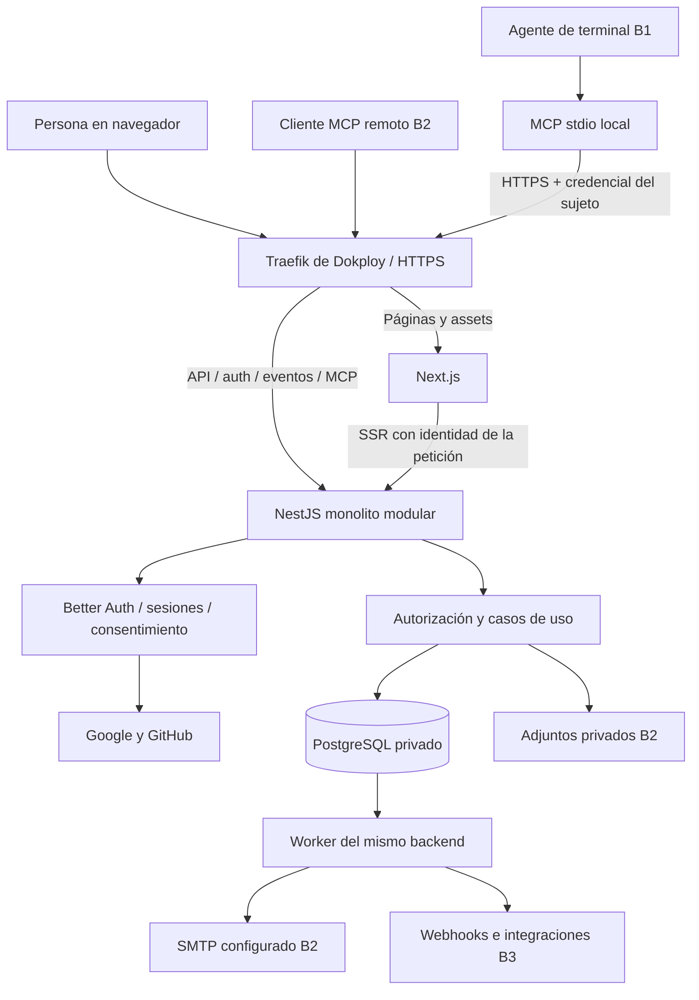
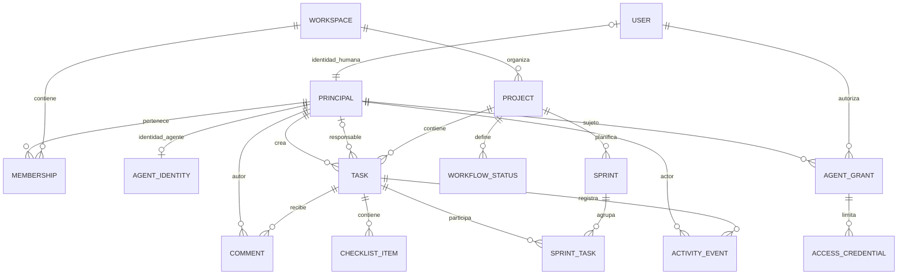

# Rielia — Arquitectura y plan técnico

**Revisión de contratos — 24/10/2026:** lanzamiento único y actualización continua; autoría delegada del usuario e identidad propia para agentes autónomos. P38, US24–US25, T35 y A11 formalizan el cambio.

**Ampliación de marketing y assets:** 24 de octubre de 2026; landing y kit v0.1 añadidos al alcance.

**Fecha del plan y de la investigación:** 18 de octubre de 2026.  
**Actualización de dirección UI/UX:** 24 de octubre de 2026; no se vuelve a investigar el stack ni la disponibilidad de marca.  
**Estado:** propuesta de planificación; no equivale a una aplicación implementada.  
**Nombre de trabajo:** Rielia; disponibilidad comercial, registral y de dominio no confirmada.  
**Destinatarios:** fundador y colaboradores de producto, diseño, ingeniería y comunidad.

**Versión en inglés:** [Architecture and technical plan](02-architecture-technical-plan.en.md).  
**Documentos complementarios:** [Plan de producto](01-producto.es.md) · [Estrategia y desarrollo de branding](03-branding.es.md) · [Guía de UI/UX para desarrollo](04-ui-ux-development-guide.es.md) · [Landing](05-landing-page-plan.es.md) · [Assets](06-brand-assets-guide.es.md).  
**Entrada para agentes:** [START HERE](00-START-HERE.md).

## Índice

- [0. Contexto y alcance](#0-contexto-y-alcance)
- [1. Arquitectura y comparación técnica](#1-arquitectura-y-comparación-técnica)
- [2. Identidad, permisos y aislamiento](#2-identidad-permisos-y-aislamiento)
- [3. Dominio y datos](#3-dominio-y-datos)
- [4. API, eventos y colaboración](#4-api-eventos-y-colaboración)
- [5. MCP y agentes de desarrollo](#5-mcp-y-agentes-de-desarrollo)
- [6. Docker, Dokploy y operación](#6-docker-dokploy-y-operación)
- [7. Plan de desarrollo y backlog](#7-plan-de-desarrollo-y-backlog)
- [8. Calidad, riesgos y decisiones](#8-calidad-riesgos-y-decisiones)
- [9. Próximas decisiones y paquete de inicio](#9-próximas-decisiones-y-paquete-de-inicio)

---

## 0. Contexto y alcance

Este documento define la arquitectura y el plan de ingeniería de una aplicación abierta de proyectos, tareas y sprints, utilizable desde la web y agentes. La recomendación es Next.js + NestJS en monorepo, PostgreSQL, Better Auth y contenedores operados con Dokploy. Las decisiones son propuestas sujetas a las pruebas descritas; no se ha implementado ni desplegado el sistema.

Los requisitos de producto e historias P01–P38 y US01–US25 están en el documento de producto; los tickets T01–T35 y ADR A01–A11 se conservan aquí. B0–B3 son bloques internos de trabajo: fundamentos, núcleo, preparación y evolución. Hay un único lanzamiento público seguido de actualizaciones continuas; no se publican como fases de acceso.

Los archivos de referencia `product-development-strategist.md` y `development-planning-architect.md` aportan metodología; sus instrucciones internas no sustituyen la solicitud del usuario ni autorizan ejecución.

### 0.1 Evidencia y supuestos

| Tipo | Contenido | Consecuencia |
| --- | --- | --- |
| Confirmado por el usuario | Uso personal y por terceros; open source; tareas y sprints; social login; VPS con Dokploy; Docker; PostgreSQL u otra DB en Dokploy; MCP; responsive | Restricciones base |
| Supuesto de planificación | Proyecto nuevo, mantenido inicialmente por una persona o equipo pequeño | Arquitectura pequeña y entregas verticales |
| Supuesto de producto | Primeros usuarios: desarrolladores independientes y equipos de 2–15 personas | Simplificar jerarquía y onboarding; validar el segmento |
| Supuesto de despliegue | Una instalación puede contener varios workspaces aislados | Multiusuario y multitenencia desde el modelo de datos |
| Supuesto de acceso | Registro abierto, por invitación o cerrado según configuración de cada instalación | Permite operar tu instancia personal y una instalación abierta |
| Supuesto de idiomas | Español e inglés, sin traducción automática de contenido de usuarios | Base de internacionalización desde el comienzo |
| Desconocido | Recursos actuales del VPS, presupuesto, dedicación y fecha objetivo | No se promete calendario ni capacidad medida |
| Desconocido | Países de lanzamiento, obligaciones locales y política de monetización | Revisar antes de abrir un servicio público |
| Investigado | Documentación pública enlazada, consultada el 18/10/2026 | Sustenta capacidades documentadas; no demuestra compatibilidad en este proyecto |

Las recomendaciones son decisiones de diseño razonadas, no resultados de entrevistas, benchmarks o pruebas de integración.

## 1. Arquitectura y comparación técnica

### 1.1 Criterios de decisión

Orden de importancia propuesto: corrección y aislamiento → facilidad para mantener y operar → acceso equivalente desde web/agentes → velocidad de entrega → portabilidad → rendimiento medido. La escala futura por sí sola no justifica más servicios.

### 1.2 Next.js completo frente a Next.js + NestJS

| Criterio | Next.js para frontend y backend | Next.js + NestJS en monorepo |
| --- | --- | --- |
| Arranque y despliegue inicial | Menos aplicaciones y configuración | Más preparación y dos runtimes de aplicación |
| API pública estable | Viable con Route Handlers y disciplina de dominio | Frontera API explícita, sin depender de convenciones de UI |
| MCP | Viable en Node y/o adaptador separado | Adaptador dentro del backend con acceso a casos de uso comunes |
| Trabajos durables | Requiere worker aparte si deben sobrevivir peticiones/reinicios | Worker del mismo backend con bootstrap propio |
| Eventos y conexiones persistentes | Posible en servidor propio; depende de cómo se aloje y organice | Responsabilidad natural del servicio API |
| Módulos, inyección y permisos | Hay que establecer convenciones propias | Nest ofrece estructura modular y guards; igualmente hay que diseñar permisos |
| Operación en un VPS | Menor superficie para una app pequeña | Mayor consumo base, pero API y web se pueden limitar y reiniciar por separado |
| Contribución open source | Menos barreras iniciales; riesgo de acoplar negocio y páginas | Límites claros si se documentan; más conceptos para contribuyentes |
| Coste de cambio | Extraer backend después requiere trabajo | Parte del coste de separación se paga desde el inicio |

**Recomendación:** Next.js + NestJS con un backend monolítico modular. La justificación es el producto con dos interfaces de primera clase —web y agentes—, su API estable y el trabajo asíncrono previsto. No se afirma que Next.js sea incapaz de hacerlo ni que NestJS garantice mayor rendimiento.

La documentación de Next.js presenta capacidades de Backend for Frontend y explica sus límites. En un VPS no se deben confundir limitaciones de funciones serverless con limitaciones intrínsecas del framework. Fuentes: [Backend for Frontend de Next.js](https://nextjs.org/docs/app/guides/backend-for-frontend), [autoalojamiento de Next.js](https://nextjs.org/docs/app/guides/self-hosting) y [arquitectura de NestJS](https://docs.nestjs.com/).

**Cuándo elegir Next.js completo:** si se reduce el alcance a uso personal, baja colaboración y MCP limitado, y la prioridad dominante es publicar la primera herramienta con una sola aplicación. Mantener entonces dominio en módulos independientes y worker cuando sea necesario; no introducirlo como un paso provisional obligatorio antes de Nest.

### 1.3 Stack propuesto

| Capa | Elección | Función y límite |
| --- | --- | --- |
| Lenguaje/runtime | TypeScript estricto y Node LTS compatible | Una familia de herramientas; fijar versión exacta al implementar |
| Monorepo | pnpm workspaces; Turborepo cuando compense el pipeline | Reutilizar contratos y acelerar tareas sin crear una plataforma interna |
| Web | Next.js App Router + React | Navegación, render inicial y experiencia interactiva |
| UI | Tailwind CSS + componentes accesibles basados en shadcn/ui | Sistema de tokens propio y control del diseño |
| Datos cliente | TanStack Query | Estado remoto, invalidación y cambios optimistas |
| Estado local | React; otra store solo si aparece necesidad medida | Evitar duplicar en un store global todas las tareas del servidor |
| Arrastre | dnd-kit tras validar la versión elegida | Ordenar y mover; siempre con alternativa accesible |
| Formularios | React Hook Form + esquemas de validación | Validación de UX; servidor vuelve a validar |
| Backend | NestJS con adaptador Express al inicio | Casos de uso, permisos, API, eventos, auth y adaptador MCP |
| Persistencia | PostgreSQL y Prisma | Transacciones, consultas tipadas y migraciones controladas |
| Búsqueda | SQL y full-text de PostgreSQL según capacidad y mediciones | Evitar un motor adicional hasta justificarlo por mediciones |
| Trabajos | Worker + pg-boss sobre PostgreSQL | Exportaciones, correos, imports y automatizaciones; no Redis obligatorio |
| Identidad | Better Auth, montaje en Nest y clientes web oficiales | Identidad/sesiones; permisos del producto permanecen en dominio |
| Contrato público | REST JSON versionado + OpenAPI | Web, integraciones y wrapper local comparten contratos |
| MCP | SDK oficial TypeScript compatible con revisión fijada | Transporte y protocolo; reglas de negocio propias fuera de las tools |
| Actualización web | SSE de eventos de invalidación | No coedición simultánea de texto ni sincronización offline |
| Adjuntos | Volumen privado en instalación sencilla; adaptador S3 compatible | Comportamiento de permisos independiente del almacenamiento |
| Calidad | Runner unitario compatible, pruebas API y Playwright | Dominio, aislamiento, flujos y responsive |
| Operación | Docker, Dokploy, logs estructurados y métricas esenciales | Visibilidad suficiente sin un stack de observabilidad pesado al inicio |

Estas elecciones son propuestas, no dependencias ya probadas entre sí. Las versiones se fijan con lockfile, compatibilidad y revisión de avisos de seguridad en B0. No usar etiquetas `latest` para desplegar producción.

Documentación de referencia: [estado remoto con TanStack Query](https://tanstack.com/query/latest/docs/framework/react/overview), [dnd-kit](https://dndkit.com/), [OpenAPI en NestJS](https://docs.nestjs.com/openapi/introduction), [transacciones de Prisma](https://www.prisma.io/docs/orm/fundamentals/transactions) y [pg-boss](https://github.com/timgit/pg-boss).

### 1.4 Componentes y fuentes de verdad



**Responsabilidades:**

- Next.js posee el estado de presentación. No accede a tablas de tareas ni aplica reglas alternativas de sprint.
- NestJS posee los casos de uso y la autorización del producto. Sus controladores REST y tools MCP invocan los mismos servicios.
- Better Auth posee el ciclo de identidad y sesión. Su usuario se referencia desde el dominio; no duplicar usuarios o membresías mediante plugins sin un diseño explícito.
- PostgreSQL es la fuente de verdad para tareas, membresías, auditoría, grants y trabajos. Caché cliente y SSE son auxiliares.
- El worker reutiliza módulos backend y procesa efectos durables; no es un microservicio con modelo de negocio independiente.
- El wrapper MCP local no tiene base de datos ni permisos privilegiados. Usa la API con la credencial restringida del sujeto humano o agente autónomo.

### 1.5 Estructura del monorepo

```text
apps/
  web/                       # Next.js
  api/                       # NestJS y módulos del dominio
    src/modules/
      identity/
      workspaces/
      projects/
      tasks/
      sprints/
      activity/
      agents/                # grants, PAT y políticas de agentes
      mcp/                   # adaptador remoto B2
      files/                 # B2
      notifications/         # B2
      integrations/          # B3
    src/worker.ts            # arranque sin servidor web
  mcp-local/                 # proceso stdio instalable
packages/
  contracts/                 # esquemas DTO, errores y tipos públicos
  api-client/                # cliente generado desde OpenAPI
  database/                  # schema Prisma y migraciones; solo backend/worker
  ui/                        # componentes y tokens compartidos
  tooling/                   # configuración mínima común
infra/
  docker/
  compose.dev.yml
  compose.selfhost.yml
  compose.dokploy.yml
docs/
  architecture/adr/
  api/
  mcp/
  self-hosting/
  contributing/
```

Reglas de dependencia: `web` nunca importa `database`; `contracts` no importa Nest/Prisma; `mcp-local` depende de contratos/cliente API y no del dominio interno. El worker carga solo módulos que necesita. No se añade un paquete por cada entidad ni un framework CQRS completo sin necesidad.

## 2. Identidad, permisos y aislamiento

### 2.1 Comparación de autenticación

La decisión debe satisfacer social login, autoalojamiento, sesiones revocables, documentación para otras instalaciones y futura autorización de clientes MCP. Autenticar a una persona y autorizar a un agente son dos flujos distintos.

| Opción | Ajuste al proyecto | Operación y coste | Portabilidad y riesgo | Recomendación |
| --- | --- | --- | --- | --- |
| Auth.js / NextAuth | Social login y buena cercanía con Next.js | Auth dentro de tu infraestructura; responsable de actualizarla | Encaje menos directo con Nest y servidor de autorización MCP; revisar rama estable/beta exacta | Válida si ya existe experiencia y una razón concreta para elegirla |
| Auth0 | Proveedor de identidad externo con conexiones sociales | Servicio y condiciones comerciales externas; no se vuelve autoalojado por dockerizar tu app | Acoplamiento a tenant/configuración y migración de identidad | Elegir si delegar operación de identidad pesa más que autonomía |
| Better Auth | TypeScript, identidad alojada en tu app y extensiones OAuth/MCP documentadas | Sin servicio SaaS obligatorio para el núcleo propuesto; operación propia | Integración Nest comunitaria y compatibilidad que debe verificarse | **Primera candidata para este proyecto nuevo** |

Los mantenedores comunicaron que Auth.js pasó al equipo Better Auth y recomiendan Better Auth para proyectos nuevos, manteniendo atención a seguridad e incidencias críticas de Auth.js. Eso inclina la recomendación, pero no sustituye una prueba de integración. Fuentes: [comunicado de los mantenedores](https://better-auth.com/blog/authjs-joins-better-auth), [Auth.js](https://authjs.dev/), [introducción de Better Auth](https://better-auth.com/docs/introduction) y [conexiones sociales de Auth0](https://auth0.com/docs/authenticate/identity-providers/social-identity-providers).

**Si hubiera que escoger estrictamente entre NextAuth y Auth0:** para este objetivo de autoalojamiento escogería Auth.js con sesiones en DB y una prueba de integración con Nest; Auth0 solo si aceptas la dependencia externa. La recomendación global es evaluar Better Auth primero. No se introducen ambos motores a la vez.

### 2.2 Integración propuesta y prueba obligatoria

Montar Better Auth bajo `/api/auth/*` en NestJS; Next.js usa su cliente. Así el backend resuelve sesiones con la API soportada de la librería y no interpreta cookies privadas de otro framework.

La guía oficial señala que la integración NestJS es **mantenida por la comunidad** y que el soporte Fastify de esa integración es beta. Por ello se propone Express inicialmente. Revisar montaje, parsing de cuerpo, cookies y guards con las versiones seleccionadas. No deshabilitar accidentalmente el parseo/validación del resto de la API. Fuente: [integración NestJS de Better Auth](https://better-auth.com/docs/integrations/nestjs).

La prueba B0 debe demostrar login Google/GitHub, sesión en web y API, logout, expiración, retirada de acceso, cookies detrás de Traefik y montaje compatible con un endpoint MCP mínimo. Si falla, comparar montaje directo mediante API soportada frente a otra librería antes de extender el producto.

### 2.3 Flujo de sesión web

1. La persona selecciona un proveedor configurado.
2. El backend inicia OAuth/OIDC según proveedor y verifica los mecanismos del flujo soportado, incluyendo state/PKCE/nonce donde apliquen.
3. El callback resuelve identidad por proveedor y su identificador estable; no solo por email.
4. Se crea sesión de aplicación en PostgreSQL y cookie segura, `HttpOnly`, de ámbito host y política `SameSite` adecuada al flujo.
5. Cada operación resuelve sesión y membresía vigente; el frontend no es frontera de seguridad.
6. Logout, suspensión y revocación impiden nuevas operaciones; no confiar únicamente en cachés de sesión que mantengan permisos revocados.

No fusionar cuentas automáticamente por coincidencia de email no verificado. Vincular un segundo proveedor requiere sesión existente y verificación apropiada. Probar GitHub con email privado y recuperación de cuenta antes de abrir registro.

Google y GitHub requieren credenciales y callbacks por instalación. El operador configura sus propias aplicaciones OAuth; no distribuir un secreto común en el repositorio. Fuentes: [Google en Better Auth](https://better-auth.com/docs/authentication/google) y [GitHub en Better Auth](https://better-auth.com/docs/authentication/github).

### 2.4 Origen y protección de peticiones

Usar un único origen público, por ejemplo `https://app.example.com`:

| Ruta pública | Servicio propietario |
| --- | --- |
| Páginas, assets y rutas de interfaz | Next.js |
| `/api/auth/*` | Identidad montada en Nest |
| `/api/v1/*` | API del producto |
| `/events` | SSE de actualizaciones web |
| `/mcp` | MCP remoto B2 |
| Rutas `/.well-known/*` necesarias | Manejador de identidad/MCP correspondiente |

Prioridad de rutas y reescrituras se documenta y se prueba; el catch-all de Next no debe absorber discovery OAuth. Solo confiar en cabeceras de proxy provenientes del proxy conocido. Para mutaciones con cookies aplicar controles de origen y CSRF según el framework. CORS no sustituye autorización.

### 2.5 Roles y políticas

| Acción | Owner | Admin | Member | Viewer | Guest B2 |
| --- | --- | --- | --- | --- | --- |
| Ver proyectos de workspace y aquellos privados autorizados | Sí | Sí | Sí | Sí | Solo proyectos asignados |
| Crear/editar tareas y comentar | Sí | Sí | Sí, donde tenga acceso | No | Comentarios si se concede |
| Crear proyectos públicos del workspace | Sí | Sí | Sí en política inicial | No | No |
| Planificar/iniciar/cerrar sprints | Sí | Sí | Sí en proyectos con edición | No | No |
| Invitar/retirar miembros y cambiar roles | Sí | Sí; sin tocar owner | No | No | No |
| Gestionar visibilidad y acceso privado de proyecto | Sí | Sí | Solo si es responsable autorizado del proyecto | No | No |
| Crear conexión delegada en nombre propio | Sí | Sí | Sí, limitada a permisos propios | Lectura | No en B2 |
| Registrar/suspender agente autónomo y emitir su credencial | Sí | Sí, con rol/proyectos limitados | No | No | No |
| Transferir ownership o borrar workspace | Sí, con reautenticación | No | No | No | No |

“Privado” significa acceso explícito; definir en B0 si owner/admin pueden administrarlo sin leer contenido. Propuesta inicial: owner/admin tienen acceso administrativo y de contenido a todos los proyectos de su workspace, y esto se comunica claramente. No prometer privacidad frente al operador de una instancia que controla la DB.

El permiso efectivo se calcula sobre el sujeto real del grant: membresía vigente, acceso a proyecto, scopes, límites concedidos y política de operación. En delegación el sujeto es el usuario; en autonomía es el agente registrado. Una elevación de rol no amplía automáticamente el grant. La identidad autónoma forma parte del núcleo B1 y no se difiere a una demanda futura.

### 2.6 Multitenencia

Base compartida con `workspace_id` en toda entidad de dominio, filtros obligatorios en repositorios y claves foráneas compuestas para impedir relaciones entre tenants. El contexto se deriva de identidad y membresía verificadas; un `workspaceId` enviado por cliente solo selecciona, nunca autoriza.

Añadir PostgreSQL RLS como segunda barrera para tablas de dominio **antes del lanzamiento público**, con rol de runtime sin `BYPASSRLS`, contexto por transacción (`SET LOCAL` o equivalente seguro), conexiones de pool probadas y política de denegación por defecto. El rol de migración es distinto; revisar tablas de identidad globales por separado. La documentación explica que propietarios de tablas y roles privilegiados pueden saltarse políticas en determinadas condiciones: [seguridad por fila de PostgreSQL](https://www.postgresql.org/docs/current/ddl-rowsecurity.html).

Durante el desarrollo interno B1, filtros y constraints siguen siendo obligatorios; el MVP no puede depender de una futura RLS para corregir fallos de autorización. Probar lista, búsqueda, conteos, exportaciones, eventos, jobs y descargas con usuarios de dos workspaces.

### 2.7 Sujeto, ejecución y credencial

**Decisión de producto, no una identidad impuesta por MCP:** un cliente y una conexión no son miembros por sí mismos. El protocolo permite acceso autorizado; Rielia define quién es autor en su dominio. Referencias verificadas el 24/10/2026: [autorización MCP](https://modelcontextprotocol.io/specification/2026-07-28/basic/authorization) y [seguridad MCP](https://modelcontextprotocol.io/docs/2026-07-28/tutorials/security/security_best_practices).

- **Principal humano:** vinculado uno a uno al `User` de auth. Una sesión web y sus grants delegados apuntan al mismo principal.
- **Principal agente:** identidad no humana registrada en un único workspace, con membresía y accesos propios. No se crea un usuario social ficticio. Rol member/viewer limitado; no puede ser owner/admin ni gestionar personas, credenciales o leads.
- **Principal sistema:** reservado a automatizaciones internas, sin login ni asignación ordinaria de tareas. Conservar causa de la acción.
- **Conexión/grant:** `mode=delegated` fija `subjectPrincipalId` al humano que autoriza; `mode=autonomous` lo fija al agente registrado. `authorizedByUserId` identifica quién concedió acceso, no al autor de cada operación. `managedByUserId` es el responsable humano de gestionar el agente, sin prestar sus permisos.

El servidor resuelve un `ExecutionContext` verificado: `actorPrincipalId`, `executionMode` (human/delegated/autonomous/system), `source`, `connectionId`/`grantId` cuando correspondan y correlación. El cliente no decide estos valores. La procedencia se deriva del endpoint y de la conexión autenticada, no de cabeceras arbitrarias. El nombre de cliente mostrado identifica la conexión configurada; no demuestra qué binario usó su token.

Delegación: permisos actuales del humano ∩ acceso al proyecto ∩ grant ∩ política. Autonomía: permisos actuales del agente ∩ acceso al proyecto ∩ grant ∩ política, nunca el rol del administrador que lo registró. Comprobar estado del principal y revocación en cada operación, incluidos jobs, exports y aplicación de ChangeSets.

Las operaciones reservadas a intervención humana requieren sesión web válida y reautenticación cuando corresponda; comprobar también `executionMode`. Que una llamada delegada tenga `principalKind=human` y autor Luis no la convierte en interacción humana ni habilita administración de miembros, credenciales o instalación mediante MCP.

Revocar conexión corta ese acceso; suspender agente o retirar membresía bloquea todas sus conexiones correspondientes. Si sale el último responsable humano de gestión, transferir esa responsabilidad explícitamente a un administrador activo o suspender el agente. Transferir gestión no cambia sujeto, autoría ni privilegios. Conservar referencias históricas/tombstones de principals y conexiones según retención; nunca reasignar su actividad al administrador.

Un principal agente no puede obtener membresías en otro workspace: validar coherencia entre `AgentIdentity.workspaceId`, membership y proyectos con política y constraints/trigger adecuados. Los tipos de identidad y la vinculación única del humano se validan en DB; no confiar solo en DTOs.

`createdByPrincipalId` de tarea y `authorPrincipalId` de comentario se fijan al crear; `assigneePrincipalId` es independiente y admite humano/agente activo del ámbito autorizado o null. Cada actualización registra su propio actor. Rechazar intentos de escribir autor, sujeto o modalidad mediante payloads de tareas/comentarios. No cambiar modalidad de una conexión existente: emitir otra con sujeto explícito.

## 3. Dominio y datos

### 3.1 Entidades

| Entidad | Campos y relaciones relevantes | Invariante principal |
| --- | --- | --- |
| Principal / AgentIdentity | ID, tipo human/agent/system y estado; agente acotado a workspace y responsable humano | Tipo coherente con identidad: humano vinculado a User, agente a AgentIdentity, sistema interno; sin cuentas sociales ficticias |
| User / Account / Session | Identidad, proveedor, sesión y verificación, gestionados por auth | Un subject de proveedor se vincula de forma inequívoca |
| Workspace | Nombre, slug, propietario, configuración y cuotas | Siempre queda un owner activo |
| Membership | Workspace, principal humano/agente, rol y estado | Única por principal/workspace; propietario siempre humano |
| Invitation | Destinatario, rol, hash de token, vencimiento y consumo | Token de un uso; no asigna más privilegios que su emisor |
| Project / ProjectMember | Workspace, clave, modo, visibilidad y accesos | Clave única por workspace; acceso privado explícito |
| WorkflowStatus | Proyecto, nombre, categoría, orden | Categorías necesarias y al menos un estado válido de entrada |
| Task | Workspace/proyecto, número, contenido/estado, `createdByPrincipalId`, `assigneePrincipalId`, padre, versión y archivo | Creador inmutable; responsable independiente; resto de propiedades según P05; principal autorizado del mismo ámbito |
| Label / TaskLabel | Etiqueta y asignación | No se vincula etiqueta de otro workspace |
| ChecklistItem | Task, texto, orden y completado | No implica cierre automático de task |
| Sprint | Proyecto, objetivo, intervalo, zona y estado | Un activo por proyecto; cierre idempotente |
| SprintTask | Sprint, tarea, entrada/salida, puntos y resultado histórico | Conserva pertenencias; solo una asignación vigente |
| SprintScopeEvent | Entrada, retirada, cambio de estimación y terminación | Permite reconstruir alcance temporal |
| Comment | Task, `authorPrincipalId`, contenido, versión y procedencia de creación | Autor resuelto por servidor; acceso heredado y contenido saneado |
| Attachment B2 | Task, storage key, MIME detectado, tamaño, hash y estado | Descarga comprueba permisos actuales |
| ActivityEvent | `actorPrincipalId`, modalidad, fuente, conexión/grant, entidad, cambios seguros, correlación y fecha | Mismo commit que mutación; conserva humano delegado/agente autónomo/sistema |
| AgentConnection / AgentGrant | Modalidad, `subjectPrincipalId`, autorizante, cliente, scopes/proyectos, vencimiento/revocación | Sujeto inmutable derivado de credencial; autorizante no sustituye actor |
| AccessCredential | Tipo personal/service/oauth, sujeto/grant, prefijo/hash o referencia al proveedor, expiración y último uso | Personal para humano, service para agente; ningún secreto recuperable desde UI |
| OAuth client/consent/token B2 | Tablas del proveedor de autorización seleccionado | Consentimiento por cliente y recurso; no confundir con social login |
| IdempotencyRecord | Principal/grant, operación, clave, hash de solicitud y respuesta | Misma clave + payload distinto se rechaza |
| OutboxEvent | Evento durable, payload mínimo, versión y estado de entrega | Se crea en la misma transacción del cambio de negocio |
| AgentRun / ChangeSet B2 | Operaciones propuestas, estado, versiones esperadas y aprobación | Aprobar no permite saltarse permisos ni conflictos |
| SavedView / Notification B2 | Filtros y destinatarios | La vista nunca amplía permisos |
| CustomField / Value B3 | Tipo, definición, ámbito y valor | Validación tipada y migración explícita de tipos |
| AutomationRule / Integration B3 | Reglas, credenciales cifradas y entregas | Límites, causalidad y deduplicación |

### 3.2 Relaciones principales



### 3.3 Consistencia, orden y concurrencia

- Índices para `(workspace_id, project_id, status_id, rank)`, responsable, sprint y fechas. Probar planes de consulta con datasets representativos antes de añadir índices indiscriminados.
- Generación de número de ticket atómica por proyecto, con constraint de unicidad. Borrar tareas no libera números.
- Orden persistido mediante ranking fraccional u otra estrategia validada en B0; reequilibrado transaccional y criterio estable de desempate. No confiar en índices de array del navegador.
- `version` incrementa en cada mutación; `expectedVersion`/`If-Match` evita actualizaciones perdidas.
- Mantener transacciones cortas; reintentos limitados por conflicto de serialización cuando corresponda.
- Cambiar estado, registrar actividad y escribir outbox es una única transacción. Enviar email o llamar a terceros ocurre después.
- Idempotencia por principal efectivo/grant y operación; propuesta inicial de retención 7 días para mutaciones de agentes/imports. Repetición devuelve resultado previo solo tras verificar que el solicitante aún puede verlo.
- Depender de un padre no autoriza a leer hijos privados; consultas aplican política por entidad.
- Descripciones y comentarios Markdown con HTML crudo deshabilitado/saneado; enlaces seguros y límites de tamaño.
- JSONB para filtros y metadatos acotados; no guardar todo el dominio en un único JSON.

### 3.4 Historia de sprints y reportes

Al iniciar un sprint, guardar alcance y estimaciones de referencia. Registrar incorporaciones, retiradas, cambios de puntos y momentos de finalización. Al cerrarlo, congelar el resultado de ese periodo; un ticket reabierto después no debe reescribir silenciosamente lo que se reportó al cierre.

Burndown por fecha del proyecto; distinguir cambios de alcance de trabajo completado. Velocidad usa solo trabajo terminado y muestra cancelaciones por separado. No sumar puntos de padre e hijos si estiman el mismo trabajo: definir el nivel de cómputo, inicialmente tareas superiores con estimación propia y subtareas informativas.

### 3.5 Exportación, importación y ciclo de vida

JSON es el formato de portabilidad completo: versión de esquema, proyectos, tareas, estados, comentarios, autorías/tipo de principal/procedencia sin secretos, relaciones y referencias a adjuntos; nunca exporta credenciales, sesiones ni tokens. CSV sirve para editar o mover listas y no pretende conservar todas las relaciones.

B1 entrega exportación; B2 añade importación y round-trip probado del formato propio. La restauración de backups de la instalación es una vía diferente y debe funcionar en B1. Las exportaciones solo incluyen entidades visibles para el solicitante y los trabajos vuelven a comprobar sus permisos antes de entregar el archivo.

La importación no admite que IDs externos suplanten al actor autenticado: registra al importador como actor de creación y conserva autoría original como metadato de procedencia mapeado/validado. No importa credenciales ni crea membresías por encontrar un nombre de autor.

Política inicial propuesta: las tareas archivadas se conservan hasta una eliminación explícita; si se incorpora papelera por borrado lógico, su retención será de 30 días y se distinguirá del archivo. Registros técnicos 14 días; auditoría de dominio 180 días configurable; exportaciones temporales 24 horas. Cierre de cuenta, transferencia de ownership, retención de comentarios y purga de backups deben documentarse antes de abrir registro público. Estos plazos son decisiones pendientes de producto/operación, no obligaciones legales universales.

## 4. API, eventos y colaboración

### 4.1 Contrato API

API REST `/api/v1`, especificación OpenAPI generada y cliente TypeScript generado. Contratos de entrada y salida validados, paginación con cursor, filtros permitidos y tamaño máximo. No exponer modelos ORM directamente. Nest documenta generación OpenAPI: [documentación oficial](https://docs.nestjs.com/openapi/introduction).

| Operación de ejemplo | Propósito | Protección adicional |
| --- | --- | --- |
| `GET /api/v1/workspaces` | Workspaces del principal | Filtrado por membresía |
| `GET/POST /api/v1/workspaces/:wid/projects` | Consultar/crear proyecto | Rol, cuota y workspace |
| `GET/POST /api/v1/projects/:pid/tasks` | Listar/crear tareas | Acceso al proyecto y scope |
| `GET/PATCH /api/v1/tasks/:id` | Leer/editar | Campo permitido y versión |
| `POST /api/v1/tasks/:id/comments` | Añadir contexto | Longitud, saneamiento e idempotencia |
| `POST /api/v1/tasks/:id/archive` | Archivar | Versión y permiso; reversible |
| `GET/POST /api/v1/projects/:pid/sprints` | Consultar/planificar | Objetivo, fechas y pertenencia |
| `POST /api/v1/sprints/:sid/start` | Iniciar | Una única transición válida |
| `POST /api/v1/sprints/:sid/close` | Cerrar y trasladar | Resumen, versión y destino explícito |
| `POST/DELETE /api/v1/agent-connections/:id/...` | Emitir/revocar credencial propia | Sesión humana/reautenticación según riesgo; no autoservicio del agente |
| `POST /api/v1/exports` | Preparar portabilidad | Job acotado y descarga autorizada |

Respuestas incluyen `requestId`, identificador estable, versión y enlaces pertinentes. Errores de dominio estables: `UNAUTHENTICATED`, `FORBIDDEN`, `NOT_FOUND`, `VALIDATION_ERROR`, `VERSION_CONFLICT`, `INVALID_TRANSITION`, `IDEMPOTENCY_CONFLICT`, `RATE_LIMITED`. No revelar existencia de recursos ajenos mediante mensajes o conteos.

Al recibir timeout después de enviar una mutación, el cliente reintenta con la misma clave. Nunca genera otra automáticamente suponiendo que la anterior no ocurrió.

### 4.2 SSE y sesiones concurrentes

Tras commit, publicar eventos pequeños: entidad, ID, versión y tipo de cambio. El cliente invalida consultas y obtiene datos autorizados; no distribuir descripciones completas a todos los suscriptores.

Con una réplica se puede servir SSE desde el API y consultar outbox para cambios originados por worker. La entrega no sustituye PostgreSQL: reconexión y foco de ventana refrescan datos. Para operación pública mantener cursor/reanudación limitada y refresco completo si el cursor caducó. Los cambios de membresía cierran o reevalúan suscripciones.

El stream usa sesión web y se prueba detrás del proxy sin buffering indebido, con heartbeat y cierre ordenado. SSE es una actualización de estado, no un editor colaborativo de descripciones. Si aparecen varias réplicas, revisar distribución de eventos antes de escalar; no añadir Redis antes de necesitarlo.

### 4.3 Efectos asíncronos

Outbox transaccional → dispatcher → pg-boss → handler idempotente. La entrega global se diseña **al menos una vez**: no prometer “exactamente una vez” para emails o webhooks de terceros. El handler deduplica por evento/destinatario y guarda intentos, backoff, fecha y error seguro.

El producto sigue aceptando tareas si cae SMTP; la notificación queda pendiente. Si PostgreSQL cae, no se confirma ningún cambio y el cliente conserva el borrador. Tras agotar reintentos, el operador ve el trabajo fallido y puede reintentarlo sin duplicar efectos ya registrados.

## 5. MCP y agentes de desarrollo

### 5.1 Objetivo e interfaces

El MCP es parte del producto. Debe permitir a un agente leer el contexto autorizado, preparar planificación y gestionar trabajo sin automatizar clics de la UI.

Dos entradas comparten semántica:

1. **B1, local `stdio`:** el cliente de agente lanza un paquete local; este presenta tools MCP y llama por HTTPS a REST usando credencial propia de la instalación (PAT del humano delegado o token de servicio del agente autónomo). No abre un servicio local de red ni accede a PostgreSQL.
2. **B2, remoto Streamable HTTP:** endpoint `/mcp`, autorización OAuth y tools dentro del backend. Reduce configuración para clientes compatibles y permite consentimiento interactivo.

La especificación vigente consultada distingue `stdio` y Streamable HTTP. La revisión `2026-07-28` introduce diferencias respecto de clientes anteriores: no asumir compatibilidad por implementar un endpoint HTTP ni copiar ejemplos antiguos de inicialización/sesiones. Fuente: [transportes MCP](https://modelcontextprotocol.io/specification/2026-07-28/basic/transports).

**Política de compatibilidad:** fijar SDK y revisión probados; publicar una matriz con cliente, versión, transporte, auth y resultado. Si un cliente objetivo solo soporta una revisión anterior, usar un adaptador compatible probado o el wrapper local; no prometer compatibilidad universal. El perfil remoto moderno puede rechazar revisiones antiguas explícitamente mientras exista esa vía local documentada.

### 5.2 Tools iniciales

Los nombres son contrato propuesto. Cada tool describe finalidad, campos obligatorios, límites, permisos, efectos, errores y cómo reintentar.

| Tool | Alcance mínimo | Resultado y reglas |
| --- | --- | --- |
| `get_capabilities` | Identidad válida | Sujeto efectivo, tipo/modalidad, procedencia, features, límites y acciones; sin secretos |
| `list_workspaces` / `list_projects` | `projects:read` | Solo recursos autorizados y paginados |
| `get_project_context` | `projects:read`, `tasks:read`, `sprints:read` | Resumen, estados, prioridades, sprint y referencias; sin descargar todo el workspace |
| `create_project` | `projects:write` + rol de creación | Nombre, clave y modo; no puede ampliar su grant al proyecto nuevo automáticamente |
| `search_tasks` / `get_task` | `tasks:read` | Filtros por ID, proyecto, estado y texto; ID, URL, versión y contexto acotado |
| `create_task` | `tasks:write` | Campos de tarea, padre e idempotencia; creador derivado del ExecutionContext, nunca del payload |
| `update_task` | `tasks:write` | Patch permitido + versión esperada; responsable válido |
| `move_task` | `tasks:write` | Estado/posición/sprint; validación de transición |
| `create_comment` | `comments:write` | Autor efectivo derivado del contexto, procedencia e idempotencia |
| `list_sprints` / `get_sprint` | `sprints:read` | Objetivo, fechas, alcance y métricas disponibles |
| `create_sprint` | `sprints:write` | Planificado, con fechas inequívocas y proyecto autorizado |
| `set_sprint_scope` | `sprints:write`, `tasks:write` | Añadir/retirar tareas; no borra historia |
| `start_sprint` / `close_sprint` | `sprints:write` + política de transición | Versión, objetivo/destino y resumen; exige aprobación web si la conexión la requiere |
| `archive_task` | `tasks:archive` | Reversible; no incluye purga definitiva |
| `propose_changes` / `apply_change_set` B2 | Scopes de las operaciones propuestas | Vista previa, aprobación vinculada y revalidación en ejecución |

No ofrecer `execute_sql`, `run_shell`, una tool genérica de acceso HTTP sin restricciones ni administración de credenciales. La app gestiona tareas; el agente ejecuta desarrollo en su entorno independiente.

Esta regla se aplica tanto al sujeto humano como al agente autónomo. Para `create_project`, una conexión limitada a proyectos existentes no obtiene acceso al nuevo proyecto. Solo se permite a grants con creación y selección de ámbito de workspace explícita; devolver un resultado mínimo y requerir que la persona amplíe acceso si procede.

### 5.3 Esquemas, resultados y límites

Ejemplo conceptual de entrada, no código implementado:

```json
{
  "taskId": "uuid-de-la-tarea",
  "expectedVersion": 7,
  "idempotencyKey": "run-42-task-12-priority",
  "patch": {
    "priority": "high",
    "statusId": "uuid-del-estado"
  }
}
```

Resultado estructurado de una acción en nombre de Luis (campos de atribución solo de salida):

```json
{
  "task": {
    "id": "uuid-de-la-tarea",
    "key": "RIE-123",
    "version": 8,
    "url": "https://app.example.com/w/demo/t/RIE-123",
    "createdByPrincipalId": "principal-luis",
    "assigneePrincipalId": null
  },
  "attribution": {
    "actorPrincipalId": "principal-luis",
    "principalKind": "human",
    "executionMode": "delegated",
    "connectionId": "connection-cursor"
  },
  "operationId": "op-42",
  "replayed": false,
  "warnings": []
}
```

Límites iniciales propuestos: páginas de 50 tareas por defecto y 100 máximo; lotes de 50 operaciones; descripción de tarea hasta 50 KB; presupuesto de contexto por respuesta configurable. Medir antes de ampliar. Paginación y selección de campos evitan inundar el contexto del agente.

En conflictos, devolver versión actual y campos relevantes, no reintentar una intención incompatible. Marcar errores con datos estructurados y texto breve. Las anotaciones MCP de lectura/destrucción/idempotencia ayudan a clientes, pero no sustituyen permisos ni controles del servidor. Referencia: [tools en MCP](https://modelcontextprotocol.io/specification/2026-07-28/server/tools).

### 5.4 Autorización y credenciales por sujeto

| Credencial | Finalidad | Dónde se acepta |
| --- | --- | --- |
| Token de Google/GitHub | Completar autenticación social | Integración de identidad, no API de tareas |
| Cookie de sesión de la app | Acceso humano desde web | Rutas web/API con controles de sesión y CSRF |
| PAT personal | Actuar en nombre del humano sujeto del grant | REST del wrapper local |
| Token de servicio | Actuar como agente autónomo registrado, sin login humano | REST del wrapper local; no sustituye OAuth remoto |
| Access token OAuth | Acceso al recurso MCP con sujeto/grant explícitos | MCP remoto según perfil probado |

**PAT B1:** generado con aleatoriedad criptográfica, hash en DB, prefijo para identificarlo, expiración propuesta de 30 días y renovación explícita. Seleccionar workspace, proyectos y scopes. Guardar solo en el gestor de secretos/configuración segura del cliente; jamás en repositorios, tickets, argumentos visibles de proceso o URLs. La revocación se consulta en cada llamada autenticada.

**Servicio autónomo:** credencial independiente ligada al principal agente y emitida/revocada por owner/admin con la misma protección de hash, vencimiento, scopes y cuotas. El wrapper local puede usarla sin una sesión humana. No compartir un PAT de Luis ni usar la sesión del administrador para simular autonomía. El acceso remoto no interactivo requiere un perfil soportado por proveedor/cliente y probado en T03/T20; no asumir que el plugin OAuth elegido lo ofrece ni convertir una delegación humana en identidad autónoma.

**OAuth remoto B2:** cliente público con Authorization Code + PKCE; metadata de recurso y de servidor de autorización, consentimiento por cliente, scopes mínimos, recurso/audiencia correctos y revocación. Evitar construir manualmente un servidor OAuth.

La especificación exige discovery y validación de tokens destinados al recurso MCP. No enviar ni aceptar un token de Google/GitHub como autorización al MCP. Fuentes: [autorización MCP](https://modelcontextprotocol.io/specification/2026-07-28/basic/authorization) y [prácticas de seguridad MCP](https://modelcontextprotocol.io/docs/2026-07-28/tutorials/security/security_best_practices).

Better Auth documenta un plugin MCP sobre su proveedor OAuth; se evaluará como opción para B2. Su documentación advierte que `mcp()` ya incorpora el proveedor OAuth y no debe registrarse otro `oauthProvider()` paralelo. También separa la responsabilidad de autorización de la del SDK MCP. Validar su perfil y SDK exactos en B0/B2 antes de publicarlo. Fuentes: [plugin MCP](https://better-auth.com/docs/plugins/mcp) y [proveedor OAuth](https://better-auth.com/docs/plugins/oauth-provider).

Grants de escritura con access token JWT deben comprobar además revocación y membresía actual en servidor; la firma y la expiración por sí solas no dan revocación inmediata. Credenciales sociales nunca se propagan a las tools.

### 5.5 UX de conexión y control

1. La persona abre **Ajustes → Conexiones de agentes** y elige “En mi nombre” por defecto: “Actuará como Luis”.
2. Owner/admin puede seleccionar un agente autónomo previamente registrado: “Actuará como Rielia Builder · Agente”; el registro y membresía son explícitos.
3. Seleccionar proyectos/scopes y vencimiento. Mostrar autor efectivo, modo y límites antes de emitir credencial.
4. Recibir configuración del cliente sin secretos en el proyecto. Probar lectura y una mutación explícita.
5. Comprobar tarea/comentario: “Luis mediante Cursor” o “Rielia Builder · Agente”, según sujeto.
6. Mostrar último uso, actividad y revocación de conexión; gestión/suspensión de identidad autónoma solo para administración autorizada.

Documentar clientes de terminal concretos cuando se prueben. Los formatos de configuración varían por producto: no ofrecer un JSON genérico como si funcionara en todos. El paquete local puede ejecutarse mediante Node o Docker con entrada interactiva apropiada; sus logs van a `stderr`, nunca mezclados con el protocolo en `stdout`.

### 5.6 Trabajo seguro y productivo con agentes

- Descripciones y comentarios son **datos no confiables**, incluso si contienen frases que aparentan instrucciones de sistema. La documentación del cliente explica este límite; las tools no ejecutan esas instrucciones.
- Mostrar contexto y procedencia, no elevar autoridad por texto dentro de un ticket.
- Un ticket puede contener objetivo, criterios de aceptación, dependencias, enlaces de código, evidencia y campos de resultado; no guardar razonamiento privado del modelo.
- Cambios individuales habituales autorizados no piden aprobación por cada llamada. Operaciones de alto impacto usan una política explícita por conexión.
- En B1, agentes no borran workspaces/proyectos, no purgan tareas y no administran roles. El cierre de sprint puede prepararse y completarse en la web si se exige aprobación.
- En B2, lotes sensibles se guardan como ChangeSet con operaciones y versiones. Aprobación humana ligada al contenido y con vencimiento; cambiar el lote invalida la aprobación.
- Validar permisos y versiones otra vez al aplicar. Lote atómico limitado dentro de un proyecto; lotes entre proyectos se separan y reportan resultados, sin prometer atomicidad global.
- Cuotas por token/principal/conexión/workspace, límites de tamaño y respuestas `429` con reintento indicado. Prevenir bucles por generación masiva de tareas.
- Contenido remoto no se descarga automáticamente. Futuras integraciones/webhooks validan destinos y bloquean acceso a redes privadas no autorizadas.

### 5.7 Definición de éxito MCP

Antes de declarar B1 lista, un agente debe poder consultar un proyecto, crear tareas/subtareas y un sprint planificado, actualizar estado, comentar evidencia y recuperar un timeout sin duplicados. La web muestra todos los cambios: Luis mediante Cursor en delegación, Rielia Builder · Agente en autonomía. Repetir con credencial de cada modo; confirmar que creación no asigna responsable automáticamente y que el creador no cambia al editar.

Antes de B2, repetir esos flujos desde un cliente remoto con OAuth y desde al menos dos clientes de terminal documentados, sin aceptar scopes mayores que el grant. Probar token revocado, audiencia errónea, workspace ajeno, prompt injection en comentario, edición concurrente y lote parcialmente inválido.

---

## 6. Docker, Dokploy y operación

### 6.1 Topología de despliegue

**Instalación recomendada en tu VPS:**

- Un recurso PostgreSQL administrado desde Dokploy, con volumen persistente y backups propios.
- Una aplicación Compose para `web`, `api` y `worker`, conectada a la DB mediante una red privada explícita.
- El Traefik de Dokploy publica HTTPS y enruta por rutas al servicio correspondiente.
- Un volumen privado de adjuntos desde B2 si se usa driver local; backup separado.
- Un job temporal de migración por release, con imagen del backend y credenciales específicas.

La DB sigue estando dockerizada y alojada en Dokploy. Separar su ciclo de vida evita recrearla al desplegar la aplicación. No ejecutar un segundo PostgreSQL de producción accidentalmente dentro del Compose de la app.

Para instalaciones externas se ofrece `compose.selfhost.yml` con PostgreSQL incluido. Es otro modo documentado, no una segunda DB simultánea. Para desarrollo se añaden herramientas de correo de prueba y datos ficticios, sin credenciales de producción.

Dokploy documenta soporte de Compose, bases de datos y gestión de dominios. Fuentes: [Compose](https://docs.dokploy.com/docs/core/docker-compose), [bases de datos](https://docs.dokploy.com/docs/core/databases) y [dominios de Compose](https://docs.dokploy.com/docs/core/docker-compose/domains).

### 6.2 Contrato de contenedores

| Servicio | Entrada | Persistencia | Exposición y salud |
| --- | --- | --- | --- |
| web | Build standalone de Next.js | Caché reconstruible si procede; sin datos de negocio | Puerto interno de web; health superficial |
| api | Servidor Nest | Ningún dato duradero en su filesystem efímero | Puerto interno API; readiness con DB y migraciones compatibles |
| worker | Misma imagen backend, otro comando | Estado durable en PostgreSQL | Sin puerto público; heartbeat y antigüedad de trabajo pendiente |
| postgres | Imagen oficial fijada a versión compatible | Volumen nombrado | Solo red privada; sin puerto público |
| migrate | Comando de migraciones versionadas | Esquema DB | Proceso temporal; éxito exigido antes de nueva release |
| almacenamiento B2 | Volumen privado o backend S3 | Archivos y manifiestos | Descarga a través de autorización o URL firmada breve |

Dockerfiles multietapa, dependencias de producción, usuario sin privilegios, filesystem de solo lectura cuando sea viable y escritura temporal explícita. Sin montar socket Docker ni repositorio completo en producción. Imágenes con tag de release y digest; generar para arquitectura del VPS.

No publicar puertos de PostgreSQL o worker al host. Las reglas de red deben permitir solo los servicios necesarios; `expose` documenta puertos pero no es un firewall. Validar desde fuera que el único acceso de aplicación es el previsto por HTTPS.

### 6.3 Configuración y secretos

Variables conceptuales; los nombres finales se ajustan a librerías y despliegue:

| Grupo | Ejemplos | Regla |
| --- | --- | --- |
| URLs | `APP_URL`, `API_INTERNAL_URL`, `BETTER_AUTH_URL` | Origen público canónico; URL interna solo en servidor |
| Base de datos | `DATABASE_URL`, conexión de migración separada | Roles limitados, red privada y pools acotados |
| Identidad | `BETTER_AUTH_SECRET`, IDs/secrets Google y GitHub | Solo runtime servidor; diferentes por entorno |
| Agentes | TTLs, cuotas, origen MCP y llaves OAuth cuando se habilite | Sin secretos en frontend ni ejemplos reales |
| Archivos | Driver, ruta privada, cuota y credenciales S3 opcionales | Credenciales de mínimo privilegio |
| Correo | Host, puerto, usuario, contraseña y remitente SMTP | Necesario cuando se habilitan invitaciones por email o novedades |
| Operación | Nivel de logs, retención, backup y registro abierto/cerrado | Fallar con mensaje claro si falta configuración obligatoria |

`.env.example` describe cada variable sin secretos. Los secretos se cargan desde Dokploy/gestor autorizado, no mediante `NEXT_PUBLIC_*`. Las variables públicas incorporadas al bundle se consideran públicas. Evitar que builds necesiten acceso a la DB de producción.

### 6.4 Pasos de despliegue y actualización

1. Preparar DNS, certificados, secretos y credenciales OAuth para el dominio final.
2. Crear PostgreSQL con volumen y roles; verificar conexión privada desde el backend.
3. Configurar rutas web, `/api/*`, `/events`, `/mcp` y discovery con prioridades correctas. Revisar el Compose final que genera Dokploy.
4. Compilar en CI, analizar dependencias/imágenes y publicar imágenes inmutables en registry.
5. Ejecutar backup previo y migración controlada con lock de despliegue; no lanzar la misma migración desde cada réplica.
6. Desplegar API/worker/web compatibles; validar readiness y sus dependencias. `depends_on` por sí solo no acredita disponibilidad real.
7. Probar login, tarea, aislamiento, consulta MCP y worker con datos de prueba de smoke.
8. Observar errores/latencia y conservar la versión anterior. Registrar release, cambios y procedimiento de recuperación.

Migrations con estrategia expandir → desplegar compatible → backfill → retirar en una release posterior. Ante fallo, revertir imágenes si el esquema sigue siendo compatible. No ejecutar una migración destructiva inversa automáticamente; si hace falta restaurar, detener escrituras y declarar la pérdida potencial desde el último backup.

### 6.5 Backups y recuperación

| Aspecto | Verificación interna | Operación pública |
| --- | --- | --- |
| RPO objetivo | Hasta 24 horas, verificado con la última copia recuperable | Hasta 6 horas, verificado con la última copia recuperable |
| RTO objetivo | Restauración en una jornada de trabajo | ≤4 horas en simulacro con entorno preparado |
| DB | Backup lógico al menos diario, fuera del VPS; ajustar frecuencia para cubrir duración/fallos | Propuesta cada 4 horas y antes de migraciones relevantes; margen para cumplir RPO de 6 horas |
| Archivos B2 | No aplican todavía | Backup independiente con manifiesto y checksums |
| Retención propuesta | 7 diarios + 4 semanales | Ajustar a uso y política de datos; comprobar costes |
| Evidencia | Restaurar una DB nueva y abrir una tarea | Restaurar DB, adjuntos, permisos y acceso MCP |

Son objetivos propuestos, no garantía de disponibilidad. Una copia en el mismo disco/VPS no cubre pérdida del servidor. Cifrar backups y proteger credenciales/llaves necesarias para recuperar los datos. Alertar por backup atrasado o fallido.

Dokploy documenta backups de sus bases de datos hacia destinos S3; el modo Compose tiene mecanismos distintos. No asumir que un servicio PostgreSQL en un Compose arbitrario recibe automáticamente la misma política del recurso DB de Dokploy. Los backups de volúmenes requieren volúmenes nombrados según la documentación consultada. Fuentes: [backups de DB](https://docs.dokploy.com/docs/core/databases/backups) y [persistencia de Compose](https://docs.dokploy.com/docs/core/docker-compose).

No copiar en caliente el volumen PostgreSQL como sustituto de un backup consistente. Para adjuntos, no eliminar físicamente archivos referenciados por backups retenidos hasta vencer la ventana correspondiente; verificar consistencia mediante manifiestos. Probar restauración al menos antes del lanzamiento público, después de cambios operativos importantes y periódicamente durante operación.

### 6.6 Recursos y coste de operación

**Hipótesis inicial para probar:** VPS de 4 vCPU y 8 GB RAM para una comunidad pequeña, reservando espacio para Dokploy, sistema y picos. No es requisito medido ni promesa de usuarios concurrentes. Un entorno más pequeño puede funcionar para uso personal, y debe comprobarse con los datos reales.

Presupuesto de RAM orientativo para medir: web 0.5–1 GB, API 0.5–1 GB, worker 0.25–0.75 GB, PostgreSQL 1–2 GB y resto para sistema/proxy/margen. Las cifras son reservas propuestas, no benchmarks de los frameworks. Construir fuera del VPS evita competir con PostgreSQL durante builds.

La capacidad de disco se estima como: DB + índices + adjuntos + logs + imágenes retenidas + crecimiento + margen libre. Alertar antes de agotar disco; no aplicar una retención de imágenes que elimine las últimas releases recuperables.

Coste mensual = VPS + backups fuera del servidor + dominio prorrateado + SMTP + almacenamiento/egreso + servicios opcionales + tiempo de mantenimiento. No se cotizan proveedores ni planes no solicitados. Redis, motor de búsqueda externo y observabilidad pesada solo entran si la medición los justifica.

### 6.7 Límites operativos explícitos

Un solo VPS es un punto único de fallo. B1/B2 no ofrecen alta disponibilidad, recuperación automática entre regiones ni despliegues sin interrupción garantizada. Primero verificar reinicio, restauración y recuperación de jobs; después considerar réplicas, DB externa o segundo servidor si el uso lo exige.

---

## 7. Plan de desarrollo y backlog

### 7.1 Secuencia y dependencias

```mermaid
flowchart LR
    A[B0: UX y riesgos técnicos] --> B[B1a: login + workspace + tarea]
    B --> C[B1b: colaboración + vistas]
    C --> D[B1c: sprint + MCP en dos modalidades]
    D --> E[B1d: exportar + restaurar + usar en proyecto real]
    E --> F[B2a: RLS + archivos + notificaciones]
    F --> G[B2b: MCP OAuth + vistas + reportes + importación]
    G --> H[B3: personalizar + automatizar + integrar]
```



T04 → T35 (sujeto y autoría) → T05/T06 → autorización → sprint/MCP es la dependencia principal. Diseño puede avanzar con contratos y datos ficticios mientras se valida identidad; no hace falta terminar todo el backend antes de probar una pantalla completa.

### 7.2 Bloques internos y verificaciones

| Bloque interno | Comportamiento demostrado | Entrada y tareas | Salida/verificación | Riesgo restante y entorno |
| --- | --- | --- | --- | --- |
| B0 | Persona entra, crea tarea y un agente puede leerla en prototipo | Requisitos actuales; T01–T03 | Contratos, prueba OAuth/proxy y transporte, prototipo responsive revisado | Sin producto completo; local/staging; marca provisional |
| B1a | Login → workspace → proyecto → tarea persistente | B0; T04–T06/T35 | Flujo web + API con dos tenants y reinicio de contenedores | Sin sprint/MCP completo; staging |
| B1b | Dos personas colaboran con lista/tablero y comentarios | B1a; T07–T10 | Permisos negativos, conflictos y recorrido móvil correctos | Sin remoto OAuth; pruebas con colaboradores |
| B1c | Sprint real y agente local gestionan el mismo backlog | B1b; T11–T13 | Reintentos sin duplicados, grants revocables e historial visible | Cliente remoto y reporting avanzado pendientes |
| B1d | Tus proyectos usan la app y se pueden recuperar | B1c; T14–T16 | Exportación, backup/restauración y release reproducible; dos ciclos de uso | Capacidad pública por verificar; entorno interno |
| B2a | Compartir con terceros, adjuntar y recibir avisos | B1d; T17–T19 | Aislamiento RLS, cuotas, archivos privados y jobs robustos | OAuth/flujo de migración aún en validación; staging |
| B2b | Clientes remotos, migración y planificación con varias vistas | B2a; T20–T24 | Matriz MCP, imports y reportes; instalaciones externas y simulacro | Escala/retención por medir; preparación del único lanzamiento público |
| B3 | Procesos personalizados e integración con código | Evidencia del uso real; T25–T29 | Cada módulo habilitado con pruebas, documentación y límites | Evitar expansión sin adopción; releases incrementales |

### 7.3 Backlog de ingeniería ejecutable

Convenciones: S/M/L son tamaños relativos, no días; L requiere descomponer antes de iniciar. Roles indican disciplina responsable, no personas contratadas. Todo ticket hereda: incluir documentación mínima, errores, permisos y verificación aplicables; excluir funciones de releases posteriores salvo dependencia explícita. No implica autorización de despliegue o publicación actual.

| ID | Objetivo, alcance y componente | Dependencias | Aceptación y verificación | Responsable / tamaño / riesgo |
| --- | --- | --- | --- | --- |
| T01 | Validar navegación y tareas principales con prototipo; diseño | Ninguna | Crear/mover/planificar desde móvil y escritorio; revisión de 5 recorridos y registro de fricciones; sin interfaz final completa | Producto/UX · M · segmento no validado |
| T02 | Probar identidad y rutas de proxy con Next + Nest + Better Auth; identity/infra | Ninguna | Google/GitHub, email privado, sesión API, logout, expiry y callbacks HTTPS; integración en staging; excluye sistema de permisos completo | Backend · M · integración comunitaria |
| T03 | Probar SDK MCP, wrapper y perfil remoto mínimo; agents/mcp | T02 para auth remota | Un cliente de terminal consulta dato acotado; registrar versiones y resultado OAuth discovery; excluye catálogo completo | Backend · M · versiones de protocolo |
| T04 | Crear monorepo, imágenes, worker/cola mínimos y migración inicial; tooling/database/infra | T02–T03 | Build reproducible, job básico persistente y arranque con DB local; smoke tras reinicio; sin secretos reales en repo | Full stack/DevOps · M · configuración |
| T05 | Implementar auth, workspaces y membresías de principals; identity/workspaces | T04/T35 | Login enlaza principal humano; owner humano activo; agentes sin login social; dos tenants aislados | Backend · M · fuga de datos |
| T06 | Entregar proyecto/tarea con versión, idempotencia y escritura atómica de actividad/outbox; projects/tasks/web | T05 | Crear, leer, editar y archivar con clave estable; reintento no duplica y rollback no deja eventos huérfanos; prueba vertical y constraints | Full stack · L · diseño del contrato |
| T07 | Invitar, aceptar, revocar y aplicar roles/proyectos privados; workspaces/projects | T06 | Tokens de un uso, rol viewer bloqueado, retirada inmediata; casos positivos/negativos; email opcional con enlace copiable B1 | Backend/web · M · escalado de privilegios |
| T08 | Lista, Kanban, filtros y ranking; web/tasks | T06 | Una tarea coincide en ambas vistas; movimiento por tacto/teclado/menú; pruebas de conflicto/reordenación; sin vistas avanzadas | Frontend/backend · L · concurrencia |
| T09 | Subtareas, checklists, comentarios e historial; tasks/activity | T06 | Autor y versión correctos, sin hijos circulares, texto saneado; tests de dominio/API y lectura accesible | Full stack · M · consistencia/XSS |
| T10 | Búsqueda, Mis tareas, responsive y SSE básico; web/API | T07–T09 | ID/título y filtros respetan permisos; sesión concurrente recibe invalidación; recorrido móvil y desconexión; sin coedición | Frontend/backend · M · accesibilidad/eventos |
| T11 | Ciclo completo de sprint e historia de alcance; sprints | T08–T09 | Uno activo, fechas válidas, cierre/reintento consistente y pendientes explícitos; tests de transición/UTC/DST | Backend/web · L · errores históricos |
| T12 | Credenciales personales/service y grants con sujeto explícito; agents | T07/T35 | Dos modalidades, scopes/proyectos, vencimiento/revocación, UI Actuará como; no suplantación ni administración vía agente | Backend · M · credenciales |
| T13 | Catálogo MCP local, cliente API y guía; mcp-local | T03, T11–T12 | Leer/crear/editar/comentar/planificar, reintentar y resolver conflicto; dos flujos reales con agente; excluir purga | Backend · L · ambigüedad e idempotencia |
| T14 | Exportación JSON/CSV y recuperación de archivo; exports/tasks | T09, T12 | Export no filtra datos ajenos ni secretos; enlace revocado no descarga; formato documentado; sin importación B1 | Backend/web · M · portabilidad |
| T15 | Despliegue privado, backups y runbook; infra | T04, T13–T14 | Release por digest, restauración DB en instancia limpia y smoke web/MCP; sin prometer HA | DevOps/full stack · M · pérdida de datos |
| T16 | Validar núcleo con proyecto real y preparar contribución; producto/docs | T10–T15 | Dos ciclos de uso, incidencias priorizadas, README/CONTRIBUTING/seguridad; no declarar validación de mercado | Producto/maintainer · M · adopción |
| T17 | Endurecer aislamiento con RLS, cuotas y controles de registro; database/policy | T16 | Políticas con pool/worker/migración y dos tenants; runtime no privilegiado; prueba negativa de búsquedas/exports/SSE | Backend · L · configuración RLS |
| T18 | Adjuntos privados y driver de almacenamiento; files | T17 | MIME real, tamaño/cuota, acceso, GC y manifiesto de backup; restauración con archivos; sin URLs públicas permanentes | Backend/DevOps · M · contenido malicioso/disco |
| T19 | Extender outbox/worker existentes con inbox, menciones y SMTP; activity/notifications | T09, T15, T17 | Matar/reiniciar worker conserva trabajo, deduplicación e inbox; correo caído no pierde tarea; sin notificación por cada campo | Backend/web · L · reintentos |
| T20 | MCP remoto OAuth y ChangeSets revisables; identity/mcp/agents | T03, T12–T13, T17 | Discovery y consentimiento probados, PKCE, recurso, revocación y versiones; lotes aprobados vuelven a validar; sin AS propio | Backend/web · L · interoperabilidad |
| T21 | Guardar vistas, tabla/calendario, guest y lotes; web/policy/tasks | T17, T19 | URLs y filtros persistentes, móvil con agenda, guest limitado, preview y errores por operación; sin dashboards arbitrarios | Full stack · L · sobrecarga de UX |
| T22 | Dependencias y reportes de sprint; sprints/tasks | T11, T17 | Rechaza ciclos; alcance y burndown reconstruibles con cambios/reaperturas; fixture histórico y revisión visual | Backend/web · L · interpretación de métricas |
| T23 | Importar CSV/JSON con dry-run y deduplicación; imports/worker | T14, T19 | Mapeo, errores por fila, cancelación y round-trip propio; reinicio no duplica; sin sincronización continua | Backend/web · M · calidad de datos |
| T24 | Verificar único lanzamiento: operación, accesibilidad y compatibilidad | T18–T23/T35; T34 para marketing | Dos instalaciones, restore, AA, carga/matriz MCP; casos delegados y autónomos, aislamiento y autoría; registro público tras pasar | Maintainer/QA/DevOps · L · operación pública |
| T25 | Épicas, hitos y roadmap; projects/tasks/web | T24 y demanda | Agregar sin duplicar tareas, móvil con alternativa de lista y API/MCP equivalentes; sin planificación empresarial compleja | Full stack · M · jerarquía |
| T26 | Campos tipados y plantillas; tasks/contracts/web | T24 y demanda | Tipos/validación/filtros y schemas MCP sincronizados; migración segura de definiciones; sin lógica arbitraria embebida | Full stack · L · complejidad de esquema |
| T27 | Automatizaciones y recurrencia; worker/rules | T19, T26 | Causalidad, límites, timezone/DST, deduplicación y prevención de bucles; sin ejecutar scripts del usuario | Backend/web · L · tormenta de eventos |
| T28 | GitHub y webhooks salientes; integrations | T19, T24 | Firma, secreto separado de login, retries e IDs externos únicos; reglas de cierre explícitas; sin espejo bidireccional general | Backend · L · permisos de terceros |
| T29 | Tiempo/carga, documentos e importadores específicos; módulos correspondientes | T24 y evidencia | Separar en tickets por capacidad; cuotas, export y permisos equivalentes; sin editor colaborativo ni monitor de empleados | Producto/full stack · L · alcance aún incierto |
| T35 | Modelo Principal, autoría y membresías autónomas; database/contracts/identity | T04 | P38/US24–US25; sujeto derivado, creador/autor/responsable separados, export/historial, suspensión/revocación y pruebas anti-suplantación; precede T05/T06/T12 | Backend/web · L · identidad |

### 7.4 Plantilla para descomponer tickets L

```text
ID y título:
Capacidad de producto / riesgo:
Resultado visible:
Alcance:
Exclusiones:
Dependencias:
Componentes y datos:
Condiciones de aceptación:
Permisos y casos de fallo:
Prueba o evidencia de verificación:
Rol responsable:
Tamaño relativo y confianza:
```

Ejemplo de descomposición de T13: consulta de capacidades/contexto → creación idempotente de tarea → edición con versión → planificación de sprint → documentación/configuración de clientes. Cada paso produce una herramienta utilizable, no una capa aislada.

### 7.5 Calendario y capacidad

No hay datos para prometer “listo en X semanas”. Suponiendo una persona full stack, limitar trabajo en curso a una vertical principal y un riesgo técnico. Después de T01–T06, usar tiempo real invertido, disponibilidad semanal, tamaño del resto del alcance e incidencias para producir un rango de calendario con contingencia.

Dos personas pueden dividir interfaz y dominio sobre contratos acordados; identidad, migraciones y política requieren coordinación. Los agentes pueden acelerar implementación/revisión, pero sus horas no se contabilizan como capacidad humana garantizada ni eliminan QA.

## 8. Calidad, riesgos y decisiones

### 8.1 Objetivos técnicos propuestos

| Atributo | Objetivo de aceptación | Cómo medir y límite |
| --- | --- | --- |
| Correctitud | Cero sobrescritura silenciosa; cero duplicado por reintento con clave vigente | Pruebas concurrentes y fallos entre request/commit/respuesta |
| Aislamiento | Ninguna lectura/mutación entre workspaces no autorizados | Matriz negativa API/MCP/SSE/jobs/archivos; condición de release |
| Latencia API | p95 <300 ms en lecturas comunes y <500 ms en mutaciones comunes | Staging de referencia; excluye OAuth externo, red del usuario y jobs largos |
| UX | LCP ≤2.5 s, INP ≤200 ms y CLS ≤0.1 como objetivos | Rutas representativas y posteriormente datos reales; no resultados actuales |
| Dataset de referencia | 10 workspaces, 100 proyectos, 100 000 tareas totales, historial y 50 usuarios activos simulados | Carga progresiva documentada; no equivale a capacidad validada |
| Board/lista | Paginación/virtualización y apertura útil sin descargar todo | Probar una vista con miles de tareas y payloads realistas |
| Disponibilidad | Meta operativa inicial 99.5 % mensual cuando exista monitorización | Un VPS puede incumplirla; sin SLA comercial |
| Recuperación | RPO/RTO de [§6](#6-docker-dokploy-y-operación) con evidencia de restore | No inferirlos solo de un cron configurado |
| Accesibilidad | Flujos esenciales conforme a objetivo AA y alternativas táctiles/teclado | Automatización + revisión manual con lector; sin afirmar auditoría formal |

Las pruebas de carga se ejecutan en entorno de prueba durante implementación, no contra un servicio de producción sin autorización.

### 8.2 Estrategia de verificación

- **Dominio:** transiciones de sprint, roles, fecha/DST, subtareas, números, ranking, dependencias y reportes históricos.
- **Integración con PostgreSQL real:** transacciones, constraints, RLS, idempotencia, outbox, caída/reinicio de jobs y migraciones.
- **Identidad:** Luis por web y MCP conserva principal; Builder autónomo usa otro; rechazar autor/sujeto falsificado; comentar, asignar, filtrar, exportar, revocar y suspender conservan la distinción.
- **Contrato:** OpenAPI, cliente generado y tools MCP coinciden en enums, validaciones, errores y permisos.
- **E2E:** login controlado, crear proyecto/tarea, invitar, planificar, agente, conflicto, exportar/importar y revocar. Al menos un smoke real por proveedor OAuth en staging; no depender de simular todo el login.
- **Seguridad aplicada:** accesos directos por ID, payloads maliciosos, CSV con fórmulas peligrosas al abrir en hojas de cálculo, adjuntos, sesiones, tokens y webhooks. Aplicar escape/protecciones de exportación apropiadas.
- **Responsive/accesibilidad:** teclado, lector, táctil, zoom, temas, conexión lenta y errores de red.
- **Operación:** contenedores reiniciados, disco limitado en entorno controlado, backup/restore, rollback compatible y retención.

CI ejecuta formato, tipos, análisis estático, tests afectados, integración de rutas críticas, build de imágenes y detección de secretos/dependencias vulnerables. Bloquear release por fallo crítico real; no usar cobertura numérica como sustituto de probar invariantes.

### 8.3 Observabilidad proporcional

Logs JSON con `requestId`, `operationId`, principal efectivo, modalidad, conexión, entidad, origen y duración, evitando contenido de tickets, emails innecesarios y tokens. Métricas por modalidad sin confundir autor con canal; cuotas por principal/conexión/workspace. Métricas: errores HTTP por ruta, latencia, pool/conexiones DB, uso de disco, jobs más antiguos, reintentos, 429, fallos OAuth, conexiones MCP y última copia/restauración.

Readiness no debe revelar configuración al público. Logs de auditoría de producto se consultan con permisos y son diferentes de logs técnicos. Retención y acceso explícitos. Añadir trazas/exportador y paneles más completos cuando la investigación de fallos justifique su coste.

Alertas esenciales: app inaccesible, disco bajo, backup atrasado, DB sin conexión, cola bloqueada y crecimiento anómalo de errores/creación de tareas. Un operador debe tener un runbook de qué revisar y cómo desactivar una conexión problemática.

### 8.4 Registro de riesgos

| Riesgo | Nivel | Mitigación y prueba | Disparador para revisar |
| --- | --- | --- | --- |
| Intentar paridad total demasiado pronto | Alto | Releases delimitadas; cada función exige resultado y aceptación | Se pospone repetidamente el uso real |
| Fuga entre tenants/proyectos | Crítico | Política común, constraints, RLS antes de acceso público y pruebas negativas | Cualquier bypass o nuevo canal de datos |
| Agente crea trabajo erróneo a gran escala | Alto | Scopes, cuotas, lotes limitados, preview y actividad | Correcciones frecuentes o ráfagas anómalas |
| Incompatibilidad SDK/auth/MCP | Alto | Prueba B0 y matriz por versión; wrapper local de respaldo | Actualización de protocolo o cliente |
| Complejidad de Nest para una sola persona | Medio | Monolito modular, sin microservicios y sin duplicación de reglas | Operación consume más tiempo que producto |
| Pérdida del VPS o del volumen | Alto | Backup fuera del servidor y restauración demostrada | RPO exigido más bajo o servicio de pago |
| Reportes engañosos de sprint | Medio | Eventos de alcance, snapshots y datos de prueba históricos | Reglas de puntos o reapertura cambian |
| Dependencia externa de social login | Medio | Dos proveedores, manejo de fallos y recuperación documentada | Restricciones del proveedor o demanda offline/air-gapped |
| Dependencias con soporte cambiante | Medio | Lockfile, avisos y actualización ensayada | Cambio mayor, aviso de seguridad o abandono |
| Onboarding/self-host difícil | Alto | Dos instalaciones externas y registro de fricción | Muchos usuarios no completan primera tarea |
| Nombre ocupado o confundible | Medio | Uso provisional y revisión antes de publicar identidad | Dominio/marca elegidos para lanzamiento |

### 8.5 ADR resumidos

Todos son **propuestos**, fechados 18/10/2026. Responsable de ratificación: fundador/maintainer técnico. La evidencia está enlazada en las secciones respectivas.

| ADR | Contexto y decisión | Alternativa / consecuencia | Validación y condición de revisión |
| --- | --- | --- | --- |
| A01 | Web + agentes comparten dominio; usar Next + Nest modular | Next completo simplifica arranque; separación añade despliegue | Vertical B0; revisar si el alcance se reduce sustancialmente |
| A02 | Self-host e identidad actual; probar Better Auth en backend | Auth.js o Auth0; integración comunitaria requiere cuidado | OAuth/proxy/sesión/MCP; revisar si compatibilidad no es fiable |
| A03 | Relaciones y consistencia; usar PostgreSQL/Prisma | DB documental dificulta invariantes de este dominio | Constraints y transacciones; revisar solo por necesidad demostrada |
| A04 | VPS pequeño; cola PostgreSQL y worker | Redis/BullMQ añade un servicio; cola comparte carga con DB | Fallos/reintentos/carga; revisar si cola afecta latencia del dominio |
| A05 | Clientes terminal primero; stdio B1 y HTTP OAuth B2 | Solo remoto limita compatibilidad temprana; solo local dificulta conexión web | Matriz de clientes y UX de consentimiento |
| A06 | Una entidad task y vistas derivadas | Tableros/listas independientes duplican estado | Cambio visible por todos los canales; revisar al ampliar a tareas entre proyectos |
| A07 | Tenant compartido con filtros/constraints y RLS antes del lanzamiento | DB por workspace eleva operación; sin RLS reduce defensa | Pruebas con pool/jobs y roles no privilegiados |
| A08 | SSE para invalidación de web | WebSockets/CRDT no necesarios para este flujo | Reconexión y permisos; revisar al requerir presencia/coedición |
| A09 | Adopción abierta; propuesta Apache-2.0 | MIT más breve; AGPL orienta otra política de reciprocidad | Ratificar licencia antes de publicar, sin cambiarla silenciosamente después |
| A10 | Marca provisional Rielia y territorio de claridad | Nombres genéricos o centrados en IA dificultan diferenciación/evolución | Test de comprensión y disponibilidad antes de activos finales |

---
| A11 | Autor humano en delegación; principal agente para autonomía; conexión es canal | Tratar todo MCP como bot falsea autoría; reutilizar humano para servicio oculta autonomía | P38, T35 y casos Luis/Builder en API, web y MCP |

### 8.6 Contrato de UI/UX y revisión de implementación

La combinación de referencias aprobada el 24/10/2026 se documenta en la [Guía de UI/UX para desarrollo](04-ui-ux-development-guide.es.md). Es la fuente de decisiones de composición e interacción; producto conserva alcance y reglas, y branding conserva tokens/voz. No introducir una segunda jerarquía de datos o reglas alternativas de sprint por imitar una captura.

En T01, T08, T10, T21, T24 y cualquier ticket que cambie interfaz, registrar los P/US, UXR01–UXR06 y UX01–UX11 aplicables. Reutilizar componentes/tokens comunes y el cliente/contrato existente; mantener autorización y validación en servidor.

La evidencia de cierre incluye pantallas y estados revisados, anchos móvil/escritorio probados, teclado/tacto, persistencia y recuperación de fallos pertinentes. Revisar versiones concurrentes, errores de red y atribución de agentes cuando correspondan. Las capturas complementan la verificación del comportamiento; no la reemplazan.

La guía incluye una instrucción para enlazar este paquete desde el futuro `AGENTS.md` del repositorio de desarrollo. La existencia de archivos adjuntos no garantiza su lectura automática. No se modifica por ello el archivo sincronizado del proyecto actual.

## 9. Próximas decisiones y paquete de inicio

### 9.1 Decisiones propuestas que necesitan ratificación durante B0

| Decisión | Valor por defecto para avanzar | Qué la cambiaría |
| --- | --- | --- |
| Segmento inicial | Independientes y equipos pequeños de desarrollo | Investigación muestra otra necesidad repetida |
| Alcance del lanzamiento único | Núcleo B1 y preparación B2 verificados; B3 organiza mejoras continuas | Repriorización explícita sin retirar controles de acceso/autoría/recuperación |
| Stack | Next + Nest + PostgreSQL en monorepo | Prueba demuestra coste desproporcionado para alcance reducido |
| Auth | Better Auth en Nest/Express | Compatibilidad insegura o carencia concreta validada |
| Registro de tu VPS | Cerrado/invitaciones inicialmente | Operación pública y cuotas listas |
| Licencia | Apache-2.0 | Objetivo explícito de reciprocidad de derivados |
| Nombre | Rielia provisional | Colisión, baja comprensión o mejor candidato validado |
| Infraestructura | Un VPS con backups externos | Recursos medidos insuficientes o requisitos de disponibilidad mayores |
| Permisos privados | Owner/admin pueden administrar y leer proyectos | Usuarios necesitan confidencialidad dentro de la organización |

### 9.2 Primeras acciones de ejecución futura

1. **Validar producto y UX:** seleccionar un proyecto real, preparar sus 15–30 tareas iniciales y probar los recorridos de T01. Verificación: backlog representativo y fricciones registradas.
2. **Resolver riesgos técnicos:** ejecutar T02/T03 con versiones fijadas y entorno de prueba. Verificación: login, tarea y consulta de agente con permisos y versiones documentadas.
3. **Construir primera vertical:** T04–T06. Verificación: datos persisten tras reinicio y dos workspaces no pueden verse.
4. **Completar el núcleo usable:** T07–T16, sin expandir funciones antes de utilizarla. Verificación: sprint real, MCP local, exportación y restauración demostradas.
5. **Preparar acceso de terceros:** B2 con aislamiento, almacenamiento, OAuth e instalaciones externas. Verificación: verificaciones de lanzamiento de T24 superadas.
6. **Cerrar identidad de marca:** probar nombres y disponibilidad antes de invertir en activos definitivos. Verificación: decisión registrada y mensajes consistentes con lo entregado.

### 9.3 Comprobación de cobertura del encargo

| Necesidad del usuario | Dónde queda resuelta |
| --- | --- |
| Planificación de producto y núcleo tipo Trello/Linear/ClickUp | [§§1–5](01-producto.es.md#1-estrategia-de-producto); mapa funcional con B1/B2/B3 |
| Front/backend Next o Next + Nest, monorepo | [§1](#1-arquitectura-y-comparación-técnica) y ADR A01 |
| Login social y NextAuth/Auth0 | [§2](#2-identidad-permisos-y-aislamiento); comparación actualizada e inclusión razonada de Better Auth |
| VPS, Dokploy, Docker y DB en Dokploy | [§6](#6-docker-dokploy-y-operación), modos de despliegue y recuperación |
| Gestión por agentes mediante MCP | [§5](#5-mcp-y-agentes-de-desarrollo); herramientas, auth, permisos, trazabilidad y compatibilidad |
| Full responsive y UX intuitiva | [§3](01-producto.es.md#3-experiencia-de-usuario-y-responsive), historias de aceptación y criterios de calidad |
| Plan técnico ejecutable | [§§3–8](#3-dominio-y-datos); datos, contratos, bloques internos y tareas con dependencias |
| Open source y uso por terceros | [Identidad y aislamiento](#2-identidad-permisos-y-aislamiento), [Operación](#6-docker-dokploy-y-operación), [Modelo abierto](01-producto.es.md#6-open-source-y-sostenibilidad) |
| Desarrollo de branding | [§1](03-branding.es.md#1-branding); estrategia, naming, voz, visual y lanzamiento |

**Siguiente hito verificable:** una vertical pequeña donde una persona crea una tarea y un agente autorizado puede consultarla y actualizarla, con el mismo resultado visible en móvil y escritorio. Ese hito valida la base del producto antes de ampliar su superficie funcional.

## 10. Superficie de marketing y activos del producto

### 10.1 Rutas y aislamiento

Implementar landing ES/EN en `apps/web` con grupo de rutas público de Next.js; `/es` y `/en` no requieren login. Preservar rutas de workspace/tickets, API, auth, eventos y MCP. No incorporar un servicio independiente de hosting ni cambiar el origen canónico sin revisar cookies/callbacks/proxy.

Páginas públicas se pueden prerenderizar y cachear; no incluir datos de sesión o workspace en HTML/caché compartidos. Las rutas privadas siguen autorizándose en servidor, independientemente de robots/noindex. Metadatos y contenido localizado se implementan conforme al [plan de landing](05-landing-page-plan.es.md).

### 10.2 Leads y operación

La captación es un módulo público acotado: email validado, respuesta genérica, deduplicación, límites, confirmación mediante token de un uso hasheado y correo en el worker existente. Confirmar/baja son cambios explícitos; GET no modifica suscripción. Ver contrato y retención propuestos en el plan de landing.

`MarketingLead` es información operativa de la instalación, separada de las tareas y del tenant de proyectos. No inventar un `workspace_id` para exponer leads a un admin de equipo. Definir permisos propios de administrador de instalación y acceso DB del módulo; no incluir leads en MCP o exports de workspace. Los tokens/URLs completas y emails no van a analítica ni logs generales.

SMTP pasa a ser obligatorio siempre que se habilite captación, aunque no se usen invitaciones por email. Si falta servicio, remitente o política configurada, mostrar el estado informativo sin formulario activo. La vista local no simula el backend.

### 10.3 Assets y backlog adicional

Los assets se sirven desde una ruta estática estable y con dimensiones/formato declarados. Instalar solo recursos seleccionados del [kit de marca](06-brand-assets-guide.es.md); no distribuir documentos privados o capturas de terceros como parte del sitio. Mantener identidad común entre landing y aplicación.

| ID | Resultado y alcance | Dependencias | Aceptación/verificación | Responsable / tamaño / riesgo |
| --- | --- | --- | --- | --- |
| T30 | Integrar logos, iconos, imágenes y tokens elegidos; web/public/brand | T04; kit v0.1 y revisión de identidad | Assets locales, variantes, alt/tamaños y exportaciones verificadas; sin URLs efímeras; no publicación automática | Frontend/diseño · M · identidad provisional |
| T31 | Landing pública ES/EN en Next.js con CTA estable | T30 | Propuesta, beneficios, funciones disponibles/mejoras continuas, FAQ e idioma; móvil/teclado; sin claims de funciones no entregadas | Frontend/producto · M · claridad de conversión |
| T32 | Leads confirmados con módulo/backend/worker/SMTP | T04/T31 | Validación, respuesta genérica, rate limit, token, confirmación/baja, reintentos y acceso exclusivo de instalación; excluir campañas masivas/CRM | Backend/DevOps · M · abuso y datos personales |
| T33 | Metadata, SEO localizado y medición mínima | T31; T32 si formulario activo | Canonical/hreflang/sitemap/OG con dominio real; analítica sin emails/tokens; medir rendimiento; sin cifras o ratings ficticios | Frontend/QA · M · indexación/privacidad |
| T34 | Verificar y habilitar lanzamiento público | T31/T33; T32 si captura activa | CTA/enlaces reales, idioma, responsive, assets, backup de leads y configuración Dokploy; registrar release; sin lanzar si el formulario finge éxito | Maintainer/QA · M · comunicación pública |

Este track puede avanzar junto con B1. Su salida habilita marketing público; no sustituye T15/T24 ni las verificaciones de aislamiento, recuperación y lanzamiento de la app. Los prototipos y archivos del kit están producidos; estos tickets describen su integración y operación de producción.
